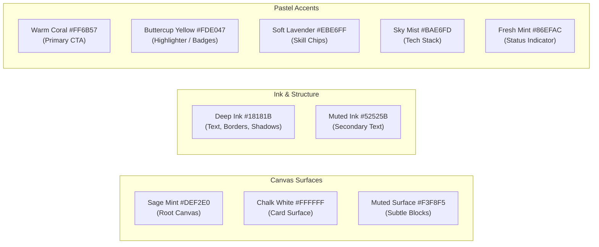

# 02 — Design Tokens & Color Palette

## 1. Palette Architecture

All 11 avatar video clips in `public/avatar/` were generated and encoded over an exact solid background. To ensure the character sits inside the UI without rectangular border seams or compression halos, the root canvas is anchored directly to **Sage Mint**.



---

## 2. Complete Token Table

| Token Variable          | Tailwind Class            | Hex Code  | OKLCH                     | Primary Application                                               |
| ----------------------- | ------------------------- | --------- | ------------------------- | ----------------------------------------------------------------- |
| `--color-canvas`        | `bg-canvas`               | `#DEF2E0` | `oklch(0.938 0.035 142)`  | Root viewport background; melts into avatar WebM video background |
| `--color-canvas-subtle` | `bg-canvas-subtle`        | `#EAF6EC` | `oklch(0.962 0.022 142)`  | Section alternation, container fills                              |
| `--color-surface`       | `bg-surface`              | `#FFFFFF` | `oklch(1 0 0)`            | Floating cards, modal sheets, dropdowns                           |
| `--color-surface-muted` | `bg-surface-muted`        | `#F3F8F5` | `oklch(0.974 0.012 145)`  | Inactive tab fills, code block headers                            |
| `--color-ink`           | `text-ink` / `border-ink` | `#18181B` | `oklch(0.205 0.005 285)`  | Primary typography, container outlines, drop shadows (Deep Zinc)  |
| `--color-ink-muted`     | `text-ink-muted`          | `#52525B` | `oklch(0.448 0.012 285)`  | Subtitles, date ranges, secondary metadata                        |
| `--color-coral`         | `bg-coral` / `text-coral` | `#FF6B57` | `oklch(0.685 0.198 28.5)` | Primary call-to-action buttons, high-energy accents               |
| `--color-yellow`        | `bg-yellow`               | `#FDE047` | `oklch(0.898 0.155 98.2)` | Highlight spans, notice badges, featured project tags             |
| `--color-lavender`      | `bg-lavender`             | `#EBE6FF` | `oklch(0.932 0.052 292)`  | Design/creative tags, secondary category badges                   |
| `--color-sky`           | `bg-sky`                  | `#BAE6FD` | `oklch(0.892 0.065 220)`  | Tech stack badges, code language pills                            |
| `--color-mint`          | `bg-mint`                 | `#86EFAC` | `oklch(0.885 0.125 152)`  | "Available for Work" pulsing indicator, success toast             |

---

## 3. Physical Neubrutalist Tokens

### Border Widths

- **Card & Container Outlines**: `2.5px solid var(--color-ink)` (`border-[2.5px] border-ink`)
- **Badges, Buttons, Chips**: `2px solid var(--color-ink)` (`border-2 border-ink`)
- **Sticky Nav Divider & Section Dividers**: `3px solid var(--color-ink)` (`border-b-[3px] border-ink`)

### Zero-Blur Hard Shadow Matrix

> [!IMPORTANT]
> **Strict Neubrutalist Rule**: Never add blur (`blur-radius > 0`) to neubrutalist shadows. Drop shadows must be crisp offsets with solid `#18181B`.

| Shadow Token         | Tailwind Utility   | CSS Value                 | Use Case                                          |
| -------------------- | ------------------ | ------------------------- | ------------------------------------------------- |
| `--shadow-brutal-xs` | `shadow-brutal-xs` | `2px 2px 0px 0px #18181B` | Small badges, active button press state           |
| `--shadow-brutal-sm` | `shadow-brutal-sm` | `3px 3px 0px 0px #18181B` | Standard buttons, input fields, pill controls     |
| `--shadow-brutal`    | `shadow-brutal`    | `4px 4px 0px 0px #18181B` | Standard project cards, hero container, modals    |
| `--shadow-brutal-lg` | `shadow-brutal-lg` | `6px 6px 0px 0px #18181B` | Featured showcase cards, interactive hover states |
| `--shadow-brutal-xl` | `shadow-brutal-xl` | `8px 8px 0px 0px #18181B` | Hero callouts, elevated overlay dialogs           |

---

## 4. Tailwind CSS v4 `@theme` Block

Defined in `app/globals.css`:

```css
@theme {
	--color-canvas: #def2e0;
	--color-canvas-subtle: #eaf6ec;
	--color-surface: #ffffff;
	--color-surface-muted: #f3f8f5;
	--color-ink: #18181b;
	--color-ink-muted: #52525b;

	--color-coral: #ff6b57;
	--color-yellow: #fde047;
	--color-lavender: #ebe6ff;
	--color-sky: #bae6fd;
	--color-mint: #86efac;

	--shadow-brutal-xs: 2px 2px 0px 0px #18181b;
	--shadow-brutal-sm: 3px 3px 0px 0px #18181b;
	--shadow-brutal: 4px 4px 0px 0px #18181b;
	--shadow-brutal-lg: 6px 6px 0px 0px #18181b;
	--shadow-brutal-xl: 8px 8px 0px 0px #18181b;

	--border-width-brutal: 2.5px;
	--border-width-thick: 3px;
}
```
