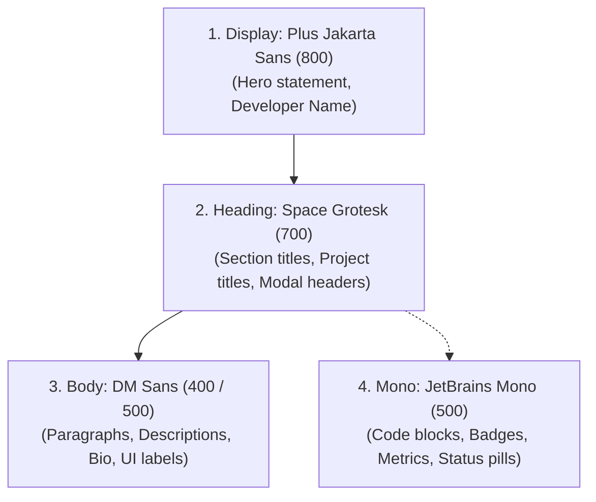

# 03 — Typography System

## 1. Type Hierarchy & Roles

Neubrutalist typography relies on **assertive contrast**: an expressive, bold display face paired with a calm, ultra-legible body face. We implement a structured 4-tier system:



---

## 2. Role Breakdown & Specifications

### 1. Display — `Plus Jakarta Sans` (Weights: 700, 800)

- **CSS Variable**: `--font-display`
- **Tailwind Class**: `font-display`
- **Characteristics**: Modern geometric sans-serif with clean proportions, confident structure, and high legibility at large weights.
- **Usage**:
  - Large Hero Headline: `"Hey, I'm Nomer"`
  - Logo Text: `"nmrisrl.dev"`
  - High-impact hero pullquotes

### 2. Heading — `Space Grotesk` (Weights: 600, 700)

- **CSS Variable**: `--font-heading`
- **Tailwind Class**: `font-heading`
- **Characteristics**: Quirky sans-serif based on Space Mono. Brings structural, engineered brutalist DNA to section headers.
- **Usage**:
  - `<h2>`: Featured Projects, Experience, Tech Stack
  - `<h3>`: Individual Project Card Titles
  - Modal titles and navigation links

### 3. Body — `DM Sans` (Weights: 400, 500, 700)

- **CSS Variable**: `--font-body`
- **Tailwind Class**: `font-body`
- **Characteristics**: Humanist geometric sans with warm terminals. Vastly superior to cold sterile fonts when paired with pastel palettes.
- **Usage**:
  - Project descriptions, longform about sections
  - Experience bullet points
  - Form field inputs and button labels

### 4. Monospace — `JetBrains Mono` (Weights: 400, 500, 700)

- **CSS Variable**: `--font-mono`
- **Tailwind Class**: `font-mono`
- **Characteristics**: Premier coding font with clean tabular digits, programming ligatures, and distinct glyphs.
- **Usage**:
  - Tech stack pills (`React`, `Next.js`, `TypeScript`)
  - Date stamps (`2023 — Present`)
  - Commit counters, code snippets, and status badges
  - Architectural blueprint micro labels and coordinate kickers (`text-2xs`)

---

## 3. Typographic Scale

| Level             | Font Family         | Size (Mobile)      | Size (Desktop)     | Weight | Tracking  | Tailwind Class          |
| ----------------- | ------------------- | ------------------ | ------------------ | ------ | --------- | ----------------------- |
| **Hero Title**    | `Plus Jakarta Sans` | `2.5rem (40px)`    | `4.5rem (72px)`    | 800    | `-0.03em` | `text-4xl` / `text-7xl` |
| **Section H2**    | `Space Grotesk`     | `1.75rem (28px)`   | `2.5rem (40px)`    | 700    | `-0.02em` | `text-2xl` / `text-4xl` |
| **Card H3**       | `Space Grotesk`     | `1.25rem (20px)`   | `1.5rem (24px)`    | 700    | `-0.01em` | `text-xl` / `text-2xl`  |
| **Body Lead**     | `DM Sans`           | `1.125rem (18px)`  | `1.25rem (20px)`   | 400    | `0`       | `text-lg` / `text-xl`   |
| **Body Base**     | `DM Sans`           | `0.9375rem (15px)` | `1rem (16px)`      | 400    | `0`       | `text-sm` / `text-base` |
| **Badge / Label** | `JetBrains Mono`    | `0.75rem (12px)`   | `0.8125rem (13px)` | 500    | `+0.02em` | `text-xs`               |
| **Micro Label**   | `JetBrains Mono`    | `0.625rem (10px)`  | `0.625rem (10px)`  | 700    | `+0.05em` | `text-2xs`              |

---

## 4. Next.js Implementation (`app/fonts.ts`)

```typescript
import { Plus_Jakarta_Sans, Space_Grotesk, DM_Sans, JetBrains_Mono } from "next/font/google";

export const fontDisplay = Plus_Jakarta_Sans({
	subsets: ["latin"],
	weight: ["700", "800"],
	variable: "--font-display",
	display: "swap",
});

export const fontHeading = Space_Grotesk({
	subsets: ["latin"],
	weight: ["600", "700"],
	variable: "--font-heading",
	display: "swap",
});

export const fontBody = DM_Sans({
	subsets: ["latin"],
	weight: ["400", "500", "700"],
	variable: "--font-body",
	display: "swap",
});

export const fontMono = JetBrains_Mono({
	subsets: ["latin"],
	weight: ["400", "500", "700"],
	variable: "--font-mono",
	display: "swap",
});
```
