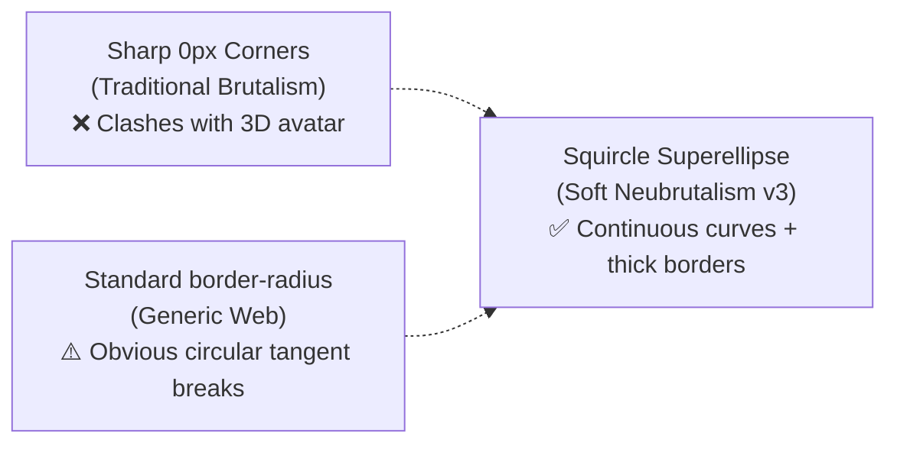

# 04 — Squircles & Shape Geometry

## 1. Why Squircles (Superellipses)?

In standard CSS, `border-radius` creates an ordinary circular fillet. When an arc transitions into a straight line, there is an abrupt curvature tangent break that the human eye perceives as robotic or cookie-cutter.

A **squircle** ($|x/a|^n + |y/b|^n = 1$, where $n \approx 4–5$) is a continuous curvature superellipse. It achieves continuous second-derivative smoothness (G2 continuity), making cards and buttons look organic, bespoke, and tactile.



---

## 2. The 3-Layer Progressive Enhancement Pattern

In `nmrisrl-v3`, we use [`@toolwind/corner-shape`](https://www.npmjs.com/package/@toolwind/corner-shape) (v0.0.8-3) which exposes utilities for the CSS Backgrounds and Borders Module Level 4 `corner-shape` specification.

### The Browser Support Challenge

To render a full superellipse curve, elements need high `border-radius` values (such as `rounded-full` or `rounded-[30px]`).
However, in browsers where `corner-shape: squircle` is not yet supported:

- If you set `rounded-full` unconditionally, a rectangular button or wide card distorts into an unwanted **oval capsule / pill**.

### The Solution: The Battle-Tested Fallback Formula

We structure classes into 3 layers:

$$\underbrace{\texttt{rounded-[fallback]}}_{\text{Layer 1: Baseline radius}} \quad + \quad \underbrace{\texttt{corner-squircle}}_{\text{Layer 2: CSS corner-shape}} \quad + \quad \underbrace{\texttt{supports-[corner-shape:squircle]:rounded-[target]}}_{\text{Layer 3: Target radius only when supported}}$$

---

## 3. Component Preset Matrix

| UI Component               | Baseline Fallback    | Target Squircle Radius  | Full Tailwind Class String                                                                                                        |
| -------------------------- | -------------------- | ----------------------- | --------------------------------------------------------------------------------------------------------------------------------- |
| **Buttons / CTAs**         | `rounded-lg` (8px)   | `rounded-full` (9999px) | `rounded-lg corner-squircle supports-[corner-shape:squircle]:rounded-full border-2 border-ink shadow-brutal-sm`                   |
| **Tech Badges / Chips**    | `rounded-md` (6px)   | `rounded-full` (9999px) | `rounded-md corner-squircle supports-[corner-shape:squircle]:rounded-full border-[1.5px] border-ink shadow-[2px_2px_0px_#18181B]` |
| **Category Tags**          | `rounded` (4px)      | `rounded-full` (9999px) | `rounded corner-squircle supports-[corner-shape:squircle]:rounded-full border-[1.5px] border-ink`                                 |
| **Card Image Windows**     | `rounded-4xl` (24px) | `rounded-[30px]`        | `rounded-4xl corner-squircle supports-[corner-shape:squircle]:rounded-[30px] border-2 border-ink`                                 |
| **Project Showcase Cards** | `rounded-2xl` (16px) | `rounded-[28px]`        | `rounded-2xl corner-squircle supports-[corner-shape:squircle]:rounded-[28px] border-[2.5px] border-ink shadow-brutal`             |
| **Avatar & Profile Frame** | `rounded-4xl` (24px) | `rounded-full` (9999px) | `rounded-4xl corner-squircle supports-[corner-shape:squircle]:rounded-full border-[2.5px] border-ink shadow-brutal`               |

---

## 4. Reusable Tailwind CSS v4 Utilities (`globals.css`)

To prevent repeatedly typing long utility chains, use these custom `@utility` classes:

```css
@import "tailwindcss";
@plugin "@toolwind/corner-shape";

@utility squircle-btn {
	border-radius: 0.5rem;
	corner-shape: squircle;
	border: 2px solid var(--color-ink);
	box-shadow: 3px 3px 0px 0px var(--color-ink);
	transition:
		transform 0.1s cubic-bezier(0.2, 0, 0, 1),
		box-shadow 0.1s cubic-bezier(0.2, 0, 0, 1);

	&:hover {
		transform: translate(-1px, -1px);
		box-shadow: 4px 4px 0px 0px var(--color-ink);
	}

	&:active {
		transform: translate(2px, 2px);
		box-shadow: 1px 1px 0px 0px var(--color-ink);
	}

	@supports (corner-shape: squircle) {
		border-radius: 9999px;
	}
}

@utility squircle-card {
	border-radius: 1.25rem;
	corner-shape: squircle;
	border: 2.5px solid var(--color-ink);
	box-shadow: 4px 4px 0px 0px var(--color-ink);

	@supports (corner-shape: squircle) {
		border-radius: 1.75rem;
	}
}

@utility squircle-badge {
	border-radius: 0.375rem;
	corner-shape: squircle;
	border: 1.5px solid var(--color-ink);
	box-shadow: 2px 2px 0px 0px var(--color-ink);

	@supports (corner-shape: squircle) {
		border-radius: 9999px;
	}
}
```
