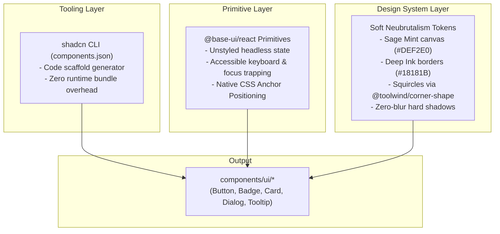

# 05 — Component System & shadcn + Base UI Architecture

## 1. The shadcn + Base UI Hybrid Architecture

In `nmrisrl-v3`, we combine **shadcn/ui's component distribution model** with **Base UI's headless primitives** ([`@base-ui/react`](https://base-ui.com)) and our **Soft Neubrutalism design tokens**.



---

## 2. Why There Are Zero Bottlenecks or Conflicts

1. **No Monolithic Runtime**: `shadcn` is not a library dependency inside `package.json`. It is purely a CLI code generator that places editable TypeScript source files directly into `components/ui/`.
2. **Headless Base UI**: Unlike UI kits that ship heavy pre-baked CSS styles, `@base-ui/react` has zero default styles and renders zero redundant wrapper divs.
3. **Token Aliasing**: In `app/globals.css`, shadcn's expected semantic variables are linked directly to your neubrutalist tokens:

```css
@theme {
	/* Semantic shadcn / Base UI Aliases */
	--color-background: var(--color-canvas); /* #DEF2E0 */
	--color-foreground: var(--color-ink); /* #18181B */
	--color-card: var(--color-surface); /* #FFFFFF */
	--color-card-foreground: var(--color-ink); /* #18181B */
	--color-primary: var(--color-coral); /* #FF6B57 */
	--color-primary-foreground: #ffffff;
	--color-secondary: var(--color-canvas-subtle); /* #EAF6EC */
	--color-secondary-foreground: var(--color-ink);
	--color-border: var(--color-ink); /* #18181B */
	--color-ring: var(--color-ink);
}
```

_When an agent or developer adds a component using shadcn's conventional classes (`bg-primary`, `border-border`, `bg-background`), it automatically inherits your exact palette without manual re-theming._

---

## 3. Configuration: `components.json`

Located in the repository root:

```json
{
	"$schema": "https://ui.shadcn.com/schema.json",
	"style": "new-york",
	"rsc": true,
	"tsx": true,
	"tailwind": {
		"config": "",
		"css": "app/globals.css",
		"baseColor": "neutral",
		"cssVariables": true,
		"prefix": ""
	},
	"iconLibrary": "lucide",
	"rtl": false,
	"aliases": {
		"components": "@/components",
		"utils": "@/lib/utils",
		"ui": "@/components/ui",
		"lib": "@/lib",
		"hooks": "@/hooks"
	}
}
```

---

## 4. Core Component Manifest

All core components live inside `components/ui/`:

### A. Button (`components/ui/button.tsx`)

- **Behavior**: Purely vertical 3D tactile click physics (`hover:-translate-y-0.5 hover:shadow-brutal-lg`, `active:translate-y-0.5 active:shadow-brutal-xs`).
- **Border & Shadow Architecture**: Built on the outset **`ring-2 ring-ink shadow-brutal`** pattern to eliminate sub-pixel anti-aliasing seams and prevent squircle border/shadow divergence.
- **Accessible Focus**: Styled with `focus-visible:outline-2 focus-visible:outline-offset-2 focus-visible:outline-ink` so focus indicators never overwrite or collide with the 2px ring outline.
- **Shape**: Squircle fallback (`rounded-lg corner-squircle supports-[corner-shape:squircle]:rounded-full`).
- **Variants**: `default` (Coral), `secondary` (Surface White), `yellow`, `lavender`, `sky`, `outline`, `ghost`.
- **Polymorphism**: Supports `asChild` for seamless `<Link>` or `<a>` nesting without invalid nested button HTML.

### B. Badge (`components/ui/badge.tsx`)

- **Behavior**: Compact pill chip with canonical `border-subtle border-ink` and 3D vertical `shadow-brutal-xs`.
- **Variants**: `default`, `coral`, `yellow`, `lavender`, `sky`, `mint`, `outline`.

### C. Card (`components/ui/card.tsx`)

- **Behavior**: Structured floating container with canonical `border-brutal border-ink` (2px) and 3D vertical `shadow-brutal`.
- **Shape**: Continuous squircle curvature (`rounded-2xl corner-squircle supports-[corner-shape:squircle]:rounded-[28px]`).
- **Subcomponents**: `CardHeader`, `CardTitle`, `CardDescription`, `CardContent`, `CardFooter`.

### D. Dialog / Modal (`components/ui/dialog.tsx`)

- **Powered by**: `@base-ui/react/dialog`.
- **Anatomy**: `Dialog`, `DialogTrigger`, `DialogContent`, `DialogHeader`, `DialogTitle`, `DialogDescription`, `DialogClose`.
- **Features**: Accessible focus lock, Escape key dismissal, backdrop dimming (`bg-ink/40 backdrop-blur-xs`), and `shadow-brutal-lg`.

### E. Tooltip (`components/ui/tooltip.tsx`)

- **Powered by**: `@base-ui/react/tooltip`.
- **Features**: Native CSS anchor positioning without JavaScript measurement jitter, squircle badge styling (`shadow-brutal-xs`).

---

## 5. Layout & Architectural Grid System (`components/page-layout/`)

The layout incorporates a 3-column structural grid framework with decorative striped gutter rails inspired by `tailwindcss.com`:

- **`PageLayout` (`components/page-layout/page-layout.tsx`)**:
  - **3-Column Architectural Framework**: `grid min-h-dvh justify-center grid-cols-1 md:grid-cols-[2.5rem_minmax(0,72rem)_2.5rem] lg:grid-cols-[3rem_minmax(0,72rem)_3rem]`.
  - **Flanking Striped Gutter Rails**: Left and right columns feature continuous vertical `border-x border-ink/15 bg-striped-rail` rails (`hidden md:block`).
  - **Single Inner Boundary**: The inner borders of the flanking rails serve as the outer boundary for the central 72rem (`max-w-6xl`) stage, preventing doubled lines.
  - **Mobile Overflow Safeguards**: Enforces `w-full overflow-x-clip`, explicit `grid-cols-1`, and `min-w-0 w-full` on child stages to guarantee zero horizontal scroll.

- **`Navbar` (`components/page-layout/navbar.tsx`)**:
  - **Persistent Floating Island Dock**: Centered header (`sticky top-0 z-50 flex w-full justify-center px-3 py-3 sm:px-6 sm:py-4`).
  - **Squircle Card Shell**: Built on `bg-surface/95 shadow-brutal ring-2 ring-ink backdrop-blur-md corner-squircle` with dynamic height scaling (`h-14 max-w-4xl` default, `h-12 max-w-3xl` scrolled).
  - **Brand Badge**: `nmrisrl` logo with a rotated Warm Coral `.dev` squircle chip (`bg-coral text-white border-subtle shadow-brutal-xs`).
  - **Direct Action**: Text-only `Let's Talk` CTA button smoothly scrolling to `#contact`. Redundant "Contact" link removed from navigation items.
  - **Mobile Dropdown & Accessible Focus**: Compact floating squircle dropdown card attached beneath the island dock with touch-friendly navigation links and full-width CTA. Mobile hamburger toggle enforces visible keyboard focus (`focus-visible:outline-2 focus-visible:outline-offset-2 focus-visible:outline-ink`).

- **`GridSection` (`components/page-layout/grid-section.tsx`)**: Reusable section container with `border-b border-ink/15`, numbered section headers (`02 // About Me`), and corner intersection crosshairs (`+`) rendered on the joints.

---

## 6. Hero Section & Marquee System (`components/sections/hero/`)

- **`HeroSection` (`components/sections/hero/hero-section.tsx`)**:
  - Natural content-driven height (`flex flex-col justify-between px-0! py-0`) avoiding excessive vertical empty space while maintaining visual balance.
  - **Avatar Stage & Floating Accents Anchor Pattern**:
    - The character avatar and all its floating graphic accents are wrapped inside a dedicated inner stage wrapper (`relative w-full max-w-65 sm:max-w-85 md:max-w-95 lg:max-w-100`).
    - This architecture ensures all absolute positions (`-left-3`, `-right-3`, `bottom-12`) anchor directly to the avatar's silhouette across all viewports (desktop, tablet, mobile), preventing badges from drifting across full-width columns on smaller screens.
    - **`RotatingSeal` (`components/sections/hero/rotating-seal.tsx`)**: Circular rotating SVG badge (`Crafted with care • 2026 • Nomer Israel • Frontend •`) with center star chip, positioned at the top-left of the avatar stage (`-top-6 -left-3 lg:-top-8 lg:-left-6`, honors `motion-reduce:animate-none`).
    - **`BauhausAccent` (`components/sections/hero/bauhaus-accent.tsx`)**: Bauhaus geometric accent pill (`● ▲ ■ SYS.V3 // CRAFT`) at the avatar's bottom-left waistline (`bottom-20 -left-3 lg:bottom-24 lg:-left-4`, `-rotate-2`).
    - **`GitCommandBadge` (`components/sections/hero/git-command-badge.tsx`)**: Neubrutalist git command pill (`>_ git commit -m "feat"`) stepped down beneath Bauhaus on the lower waist/pants (`bottom-6 left-2 lg:bottom-8 lg:left-4`, `-rotate-1`, customizable via `command` prop).
    - **`NpmDevBadge` (`components/sections/hero/npm-dev-badge.tsx`)**: Neubrutalist developer command pill (`>_ npm run dev`) framing the lower-right wrist/pocket of the avatar (`-right-2 bottom-12 lg:-right-3 lg:bottom-14`, `rotate-2`).
    - **Mobile Safeguard**: Floating badges use `hidden sm:inline-flex` (`hidden sm:flex` for RotatingSeal) to ensure clean rendering without overflow or clutter on mobile devices (`< sm`).
  - **Editorial Hero Typography**:
    - **Blueprint Coordinates**: `✦ FIG. 01 // OVERVIEW • 14°35'N 120°58'E • MNL, PH` with responsive wrapping.
    - **Availability Kicker**: `[ 🟢 AVAILABLE FOR WORK ]` squircle pill with pulsing mint indicator (equipped with `motion-reduce:animate-none`).
    - **Headline**: `Plus Jakarta Sans` headline with responsive sizing (`text-3xl sm:text-5xl`) and yellow highlight box (`beyond the code.`).
    - **Dual Action CTAs**: Clean `[ Explore Projects ]` (default coral) and `[ Get in Touch ]` (secondary white) buttons.
    - **Relocated Metrics with 200% Zoom Reflow**: Metric cards (`7+ Years`, `20+ Shipped`, `99% Web Performance`) are housed under `02 // About Me` in `app/page.tsx`, utilizing responsive flex stacking (`flex-col md:flex-row md:items-center`) to reflow vertically at narrow widths and prevent text clipping at 200% zoom.

- **`MarqueeTechStack` (`components/sections/hero/marquee-tech-stack.tsx`)**:
  - Dual-track infinite counter-translating marquee powered by `motion/react`.
  - Top track translates Left; bottom track translates Right (reverse).
  - Populated strictly from [`ProfileCoreTech`](file:///C:/Users/NOMER%20ISRAEL/OneDrive/Desktop/Projects/nmrisrl-v3/constants/stack-and-skills-data.ts) in `constants/stack-and-skills-data.ts`.
  - Contained inside the grid rails (`w-full overflow-hidden`) with refined borders (`border-t border-ink/20`, `border-b border-ink/15`) and edge fade masks (`bg-linear-to-r`).
