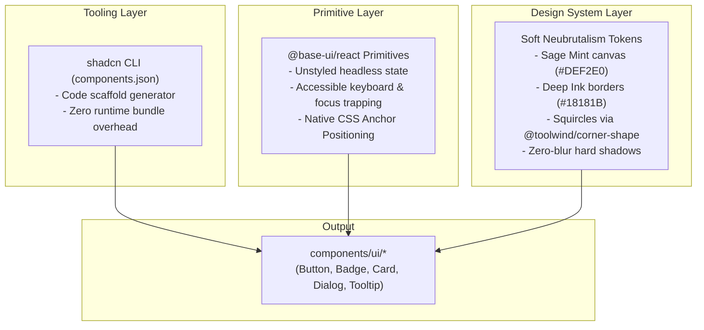

# 05 — Component System & shadcn + Base UI Architecture

## 1. The shadcn + Base UI Hybrid Architecture

In `nmrisrl-v3`, we combine **shadcn/ui's component distribution model** with **Base UI's headless primitives** ([`@base-ui/react`](https://base-ui.com)) and our **Soft Neubrutalism design tokens**.



---

## 2. Why There Are Zero Bottlenecks or Conflicts

1. **No Monolithic Runtime**: `shadcn` is not a library dependency inside `package.json`. It is purely a CLI code generator that places editable TypeScript source files directly into `components/ui/`.
2. **Headless Base UI**: Unlike UI kits that ship heavy pre-baked CSS styles, `@base-ui/react` has zero default styles and renders zero redundant wrapper divs.
3. **Token Aliasing**: In `app/globals.css`, shadcn's expected semantic variables are linked directly to your neubrutalist tokens:

```css
@theme {
	/* Semantic shadcn / Base UI Aliases */
	--color-background: var(--color-canvas); /* #DEF2E0 */
	--color-foreground: var(--color-ink); /* #18181B */
	--color-card: var(--color-surface); /* #FFFFFF */
	--color-card-foreground: var(--color-ink); /* #18181B */
	--color-primary: var(--color-coral); /* #FF6B57 */
	--color-primary-foreground: #ffffff;
	--color-secondary: var(--color-canvas-subtle); /* #EAF6EC */
	--color-secondary-foreground: var(--color-ink);
	--color-border: var(--color-ink); /* #18181B */
	--color-ring: var(--color-ink);
}
```

_When an agent or developer adds a component using shadcn's conventional classes (`bg-primary`, `border-border`, `bg-background`), it automatically inherits your exact palette without manual re-theming._

---

## 3. Configuration: `components.json`

Located in the repository root:

```json
{
	"$schema": "https://ui.shadcn.com/schema.json",
	"style": "new-york",
	"rsc": true,
	"tsx": true,
	"tailwind": {
		"config": "",
		"css": "app/globals.css",
		"baseColor": "neutral",
		"cssVariables": true,
		"prefix": ""
	},
	"iconLibrary": "lucide",
	"rtl": false,
	"aliases": {
		"components": "@/components",
		"utils": "@/lib/utils",
		"ui": "@/components/ui",
		"lib": "@/lib",
		"hooks": "@/hooks"
	}
}
```

---

## 4. Core Component Manifest

All core components live inside `components/ui/`:

### A. Button (`components/ui/button.tsx`)

- **Behavior**: Purely vertical 3D tactile click physics (`hover:-translate-y-0.5 hover:shadow-brutal-lg`, `active:translate-y-0.5 active:shadow-brutal-xs`).
- **Border & Shadow Architecture**: Built on the outset **`ring-2 ring-ink shadow-brutal`** pattern to eliminate sub-pixel anti-aliasing seams and prevent squircle border/shadow divergence.
- **Accessible Focus**: Styled with `focus-visible:outline-2 focus-visible:outline-offset-2 focus-visible:outline-ink` so focus indicators never overwrite or collide with the 2px ring outline.
- **Shape**: Squircle fallback (`rounded-lg corner-squircle supports-[corner-shape:squircle]:rounded-full`).
- **Variants**: `default` (Coral), `secondary` (Surface White), `yellow`, `lavender`, `sky`, `outline`, `ghost`.
- **Polymorphism**: Supports `asChild` for seamless `<Link>` or `<a>` nesting without invalid nested button HTML.

### B. Badge (`components/ui/badge.tsx`)

- **Behavior**: Compact pill chip with canonical `border-subtle border-ink` and 3D vertical `shadow-brutal-xs`.
- **Variants**: `default`, `coral`, `yellow`, `lavender`, `sky`, `mint`, `outline`.

### C. Card (`components/ui/card.tsx`)

- **Behavior**: Structured floating container with canonical `border-brutal border-ink` (2px) and 3D vertical `shadow-brutal`.
- **Shape**: Continuous squircle curvature (`rounded-2xl corner-squircle supports-[corner-shape:squircle]:rounded-[28px]`).
- **Subcomponents**: `CardHeader`, `CardTitle`, `CardDescription`, `CardContent`, `CardFooter`.

### D. Dialog / Modal (`components/ui/dialog.tsx`)

- **Powered by**: `@base-ui/react/dialog`.
- **Anatomy**: `Dialog`, `DialogTrigger`, `DialogContent`, `DialogHeader`, `DialogTitle`, `DialogDescription`, `DialogClose`.
- **Features**: Accessible focus lock, Escape key dismissal, backdrop dimming (`bg-ink/40 backdrop-blur-xs`), and `shadow-brutal-lg`.

### E. Tooltip (`components/ui/tooltip.tsx`)

- **Powered by**: `@base-ui/react/tooltip`.
- **Features**: Native CSS anchor positioning without JavaScript measurement jitter, squircle badge styling (`shadow-brutal-xs`).

---

## 5. App-Specific & Experience Primitives (`components/custom/`)

> **Architectural Boundary**: `@/components/ui/*` is strictly reserved for registry-backed primitives and their local styled wrappers installed or scaffolded from Base UI and shadcn registries (such as `button`, `card`, `badge`, `dialog`, `tooltip`). All bespoke application components, interactive controllers, and micro-experience features reside in `@/components/custom/*` to keep the UI directory clean and registry-compatible.

### A. Custom Cursor (`components/custom/cursor.tsx`)

- **Inspired by**: [Animate UI Cursor Primitive](https://animate-ui.com/docs/primitives/animate-ui/cursor).
- **Styling**: Coral body (`#FF6B57`), Chalk White outline (`#FFFFFF`, 2.5px), and 2px zero-blur brutal ink shadow (`drop-shadow(0px 2px 0px rgba(24, 24, 27, 0.95))`).
- **Precision Alignment**: Arrow hotspot locked to exact `(1.5px, 3px)` tip coordinates, preventing pointer click-target desynchronization.
- **Haptic Micro-interactions**: Smooth click scaling (`scale: 0.88` on press), clickable hover reactions (`scale: 1.15` and subtle tilt over buttons/links), and text caret transparency (hides over text fields).
- **Platform Safety**: Excludes touch-only devices via `(hover: hover) and (pointer: fine)` query; honors `prefers-reduced-motion`.

### B. Click Effect Primitive (`components/custom/click.tsx`)

- **Inspired by**: [Animate UI Click Primitive](https://animate-ui.com/docs/primitives/animate-ui/click).
- **5 Configurable Variants**:
  - `burst` (Default): Directional speed-lines erupting in the 180°–270° quadrant behind the arrow tip with brutal ink drop shadows.
  - `particles`: 360° radiating circular confetti with white borders (supports `multiColor` brand palette).
  - `crosshair`: Architectural 4-tick crosshair expanding outward matching `GridSection` `[+]` indicators.
  - `ring`: Tactile expanding shockwave ring.
  - `ripple`: Soft expanding radial wash.
- **Immediate Tactile Physics**: Defaults to `trigger="pointerdown"` for instant 0ms haptic response on mouse press.
- **Toggleable 3D Drop Shadow**: Includes `showShadow?: boolean` on `<Click />` (and `clickEffectShadow?: boolean` on `<CustomCursor />`) to easily switch between 3D neubrutalist drop shadows or flat, clean vectors.
- **Future Customization & SFX Hook**: Equipped with `onEffectTrigger?: (item) => void` callback ready for audio sound effects (SFX) and user preference switchers.

---

## 6. Layout & Architectural Grid System (`components/page-layout/`)

The layout incorporates a 3-column structural grid framework with decorative striped gutter rails inspired by `tailwindcss.com`:

- **`PageLayout` (`components/page-layout/page-layout.tsx`)**:
  - **3-Column Architectural Framework**: `grid min-h-dvh justify-center grid-cols-1 md:grid-cols-[2.5rem_minmax(0,72rem)_2.5rem] lg:grid-cols-[3rem_minmax(0,72rem)_3rem]`.
  - **Flanking Striped Gutter Rails**: Left and right columns feature continuous vertical `border-x border-ink/15 bg-striped-rail` rails (`hidden md:block`).
  - **Single Inner Boundary**: The inner borders of the flanking rails serve as the outer boundary for the central 72rem (`max-w-6xl`) stage, preventing doubled lines.
  - **Mobile Overflow Safeguards**: Enforces `w-full overflow-x-clip`, explicit `grid-cols-1`, and `min-w-0 w-full` on child stages to guarantee zero horizontal scroll.

- **`Navbar` (`components/page-layout/navbar.tsx`)**:
  - **Persistent Floating Island Dock**: Centered header (`sticky top-0 z-50 flex w-full justify-center px-3 py-3 sm:px-6 sm:py-4`).
  - **Squircle Card Shell**: Built on `bg-surface/95 shadow-brutal ring-2 ring-ink backdrop-blur-md corner-squircle` with dynamic height scaling (`h-14 max-w-4xl` default, `h-12 max-w-3xl` scrolled).
  - **Brand Badge**: `nmrisrl` logo with a rotated Warm Coral `.dev` squircle chip (`bg-coral text-white border-subtle shadow-brutal-xs`).
  - **Direct Action**: Text-only `Let's Talk` CTA button smoothly scrolling to `#contact`. Redundant "Contact" link removed from navigation items.
  - **Dynamic Scroll Spy & URL Hash Sync**: Active section detection at ~35% viewport reading attention line with automatic `window.history.replaceState` URL hash synchronization, hero section clearing (<180px), bottom-of-page snapping to `#contact`, and smooth scroll suppression (`scrollSuppressionUntil`) to eliminate flicker during click-to-scroll transitions.
  - **Hand-Drawn Active & Hover Annotations**: Active navigation item highlighted with a `RoughNotation` Buttercup Yellow highlight chip; hover state underlined with a Warm Coral sketch line via `useRoughNotation`.
  - **Mobile Dropdown & Accessible Focus**: Compact floating squircle dropdown card attached beneath the island dock with touch-friendly navigation links, `aria-current={isActive ? "page" : undefined}` on active items, and full-width CTA. Mobile hamburger toggle enforces visible keyboard focus (`focus-visible:outline-2 focus-visible:outline-offset-2 focus-visible:outline-ink`).

- **`GridMarker` (`components/page-layout/grid-marker.tsx`)**:
  - **Architectural Junction Anchor**: Renders at grid line corners and section divider intersections with transform-based precision centering (`-translate-x-1/2 translate-y-1/2`).
  - **Responsive Visibility & Layering**: Styled with `hidden md:flex z-20 select-none` to display exclusively when flanking architectural striped rails are active (`md:block`), eliminating 5px negative-offset mobile overflow while stacking cleanly above flanking rails and marquee masks. PageLayout applies `relative z-10` to the Center Main Stage to ensure markers stay above Column 3's gutter rail.
  - **Squircle Box Default with Progressive Fallback**: Defaults to `"squircle"` (`size-2.5 rounded-xs corner-squircle supports-[corner-shape:squircle]:rounded-full border border-ink/40 bg-surface`), providing a clean CAD terminal cap that upgrades v2's box with G2 continuous curvature.
  - **Dynamic Neu-Icons Selection**: Supports 10 handcrafted vector Neu-Icons (`diamond-star`, `cross-star`, `rounded-cross`, `propeller-star`, `trefoil-cloud`, `sunburst-flower`, etc.) as well as custom `ReactElement` overrides.
  - **Auto-Adaptive Silhouette Drop Shadows**: Automatically maps `shadow-brutal*` to `drop-shadow-brutal*` on SVG icons via boundary-safe negative lookaround regex (`(?<![\w-])shadow-brutal*`) to preserve existing drop shadows while preventing box-shadow bounding artifacts.
  - **Custom Element Styling**: Custom `ReactElement` markers receive `markerClassName` via `cloneElement` class merging (or a wrapper `<span>`) while preserving existing absolute corner positioning.

- **`GridSection` (`components/page-layout/grid-section.tsx`)**:
  - Reusable architectural section container bounded by `border-b border-ink/15` (`px-4 py-16 md:px-8 lg:px-12`).
  - **Streamlined Marker Props**: Accepts `marker?: GridMarkerVariant | ReactElement` (defaults to `"squircle"`), `markerClassName?: string`, `showMarker?: boolean` (defaults to `true`), and `showTopMarker?: boolean` (defaults to `false`).
  - **Editorial Blueprint Headers**: Supports `figure`, `figureMeta?: string | readonly string[]`, `number`, `title`, and `description` to render technical blueprint section kickers, accented by `DiamondStarIcon` (`text-coral`).

---

## 7. Hero Section & Marquee System (`components/sections/hero/`)

- **`HeroSection` (`components/sections/hero/hero-section.tsx`)**:
  - Natural content-driven height (`flex flex-col justify-between px-0! py-0`) avoiding excessive vertical empty space while maintaining visual balance.
  - **Avatar Stage & Floating Accents Anchor Pattern**:
    - The character avatar and all its floating graphic accents are wrapped inside a dedicated inner stage wrapper (`relative w-full max-w-65 sm:max-w-85 md:max-w-95 lg:max-w-100`).
    - This architecture ensures all absolute positions (`-left-3`, `-right-3`, `bottom-12`) anchor directly to the avatar's silhouette across all viewports (desktop, tablet, mobile), preventing badges from drifting across full-width columns on smaller screens.
    - **`RotatingSeal` (`components/sections/hero/rotating-seal.tsx`)**: Circular rotating SVG badge (`Crafted with care • 2026 • Nomer Israel • Frontend •`) with center `CrossStarIcon` stamp from `@/components/neu-icons` (`size-5.5 text-ink`), positioned at the top-left of the avatar stage (`-top-6 -left-3 lg:-top-8 lg:-left-6`, honors `motion-reduce:animate-none`).
    - **`BauhausAccent` (`components/sections/hero/bauhaus-accent.tsx`)**: Bauhaus geometric accent pill (`● ▲ ■ SYS.V3 // CRAFT`) at the avatar's bottom-left waistline (`bottom-20 -left-3 lg:bottom-24 lg:-left-4`, `-rotate-2`).
    - **`GitCommandBadge` (`components/sections/hero/git-command-badge.tsx`)**: Neubrutalist git command pill (`>_ git commit -m "feat"`) stepped down beneath Bauhaus on the lower waist/pants (`bottom-6 left-2 lg:bottom-8 lg:left-4`, `-rotate-1`, customizable via `command` prop).
    - **`NpmDevBadge` (`components/sections/hero/npm-dev-badge.tsx`)**: Neubrutalist developer command pill (`>_ npm run dev`) framing the lower-right wrist/pocket of the avatar (`-right-2 bottom-12 lg:-right-3 lg:bottom-14`, `rotate-2`).
    - **Mobile Safeguard**: Floating badges use `hidden sm:inline-flex` (`hidden sm:flex` for RotatingSeal) to ensure clean rendering without overflow or clutter on mobile devices (`< sm`).
  - **Editorial Hero Typography**:
    - **Blueprint Coordinates**: Rendered with `DiamondStarIcon` (`size-3 text-coral`) followed by `FIG. 01 // OVERVIEW • 14°35'N 120°58'E • MNL, PH` with responsive wrapping.
    - **Availability Kicker**: `[ 🟢 AVAILABLE FOR WORK ]` squircle pill with pulsing mint indicator (equipped with `motion-reduce:animate-none`).
    - **Headline**: `Plus Jakarta Sans` headline with responsive sizing (`text-3xl sm:text-5xl`) and yellow highlight box (`beyond the code.`).
    - **Narrative Subtitle (`HeroNarrative` in `components/sections/hero/hero-narrative.tsx`)**:
      - Hand-drawn vector annotations powered by `react-rough-notation` and `rough-notation`.
      - **Sequenced Annotation Group (`RoughNotationGroup`)**:
        - **Name Underline** (`type="underline"`): Warm Coral sketch line (`#FF6B57`) under `Data.firstName` with `strokeWidth={2.5}` and `iterations={2}`.
        - **Role Highlighter** (`type="highlight"`): Buttercup Yellow highlighter (`rgba(253, 224, 71, 0.75)`) over `Data.position.toLowerCase()` with `multiline={true}` to support line wrapping on narrow viewports.
      - **Font-Ready Measurement**: Waits for `document.fonts.ready` before triggering the annotation group, preventing bounding box calculation discrepancies with custom web typography (`DM Sans`).
      - **Accessibility & Motion Reduction (WCAG 2.3.3)**: Integrated with `useSyncExternalStore` listening to `(prefers-reduced-motion: reduce)` to disable drawing animations (`animate={!reducedMotion}`) for users requesting reduced motion without cascading re-render warnings.
    - **Dual Action CTAs**: Clean `[ Explore Projects ]` (default coral) and `[ Get in Touch ]` (secondary white) buttons.

- **`MarqueeTechStack` (`components/sections/hero/marquee-tech-stack.tsx`)**:
  - Dual-track infinite counter-translating marquee powered by `motion/react`.
  - Top track translates Left; bottom track translates Right (reverse).
  - Populated strictly from [`ProfileCoreTech`](file:///C:/Users/NOMER%20ISRAEL/OneDrive/Desktop/Projects/nmrisrl-v3/constants/stack-and-skills-data.ts) in `constants/stack-and-skills-data.ts`.
  - Individual tech items separated by vector `DiamondStarIcon` neu-icons (`size-2.5 text-ink/30`), with corner `GridMarker` junction boxes framing the top borders.
  - Edge fade masks (`bg-linear-to-r`) with track-level clipping (`overflow-hidden`).

---

## 8. About Section Bento Grid Architecture (`components/sections/about/`)

The About section showcases professional identity, core specialization, engineering metrics, architectural mindset, and personal interests structured into a high-contrast Soft Neubrutalist Bento Grid.

### A. Centralized Content Architecture (`About_Data`)

All copy, labels, metrics, bullet points, and blueprint headers across the entire About section are centralized in `About_Data` inside `@/constants/data.ts`. This decouples UI presentation from copy and guarantees that developer experience figures, technical specialties, and narrative descriptions can be updated in a single place without modifying component TSX.

### B. Modular Decomposition Pattern

To maintain clean code separation and prevent monolithic files, the 6 bento cards are decomposed into dedicated sub-packages (`bento-01/` through `bento-06/`). Each card couples structured blueprint metadata with a rich, interactive 3D visual model/assembly:

- **`AboutSection` (`components/sections/about/about-section.tsx`)**:
  - **Blueprint Header**: Rendered using `About_Data.section.figure` (`"FIG. 02 // IDENTITY & BACKGROUND"`) and `figureMeta={About_Data.section.figureMeta}` (`["SPECIALIZATION", "CRAFT & SYSTEMS"]`).
  - **12-Column Responsive Bento Layout**: `grid grid-cols-1 gap-4 sm:gap-5 md:grid-cols-2 lg:grid-cols-12`.
  - **Card Header Divider**: Cards enforce a clean bottom divider line via `border-b border-ink/15` (avoiding extra bounding borders).
  - **Card Manifest**:
    1. **`SpecializationCard` (`bento-01/specialization.tsx`, `md:col-span-2 lg:col-span-7`)**:
       - Hosts **`TechStackReactor` (`bento-01/tech-stack-reactor.tsx`)**: Centered 3D levitation reactor with rotating orbital energy rings and floating tech pills (`React`, `Next.js`, `TypeScript`, `Tailwind CSS`) powered by official Simple Icons.
       - Highlights core frontend ecosystem depth, robust type contracts, and fluid micro-interactions.
    2. **`ExperienceCard` (`bento-02/experience.tsx`, `md:col-span-2 lg:col-span-5`)**:
       - Hosts **`ExperienceHologram` (`bento-02/experience-hologram.tsx`)**: Centered 3D holographic emitter projecting 7+ years of frontend depth, designer intuition, and tactile UI craftsmanship (`EST. 2019`).
    3. **`ArchitectureCard` (`bento-03/architecture.tsx`, `md:col-span-1 lg:col-span-6`)**:
       - Hosts **`ArchitectureCartridge` (`bento-03/architecture-cartridge.tsx`)**: Centered 3D animated modular cartridge docking station illustrating clean architecture boundaries, Feature-Sliced Design, and zero-debt maintainability.
    4. **`InnovationCard` (`bento-04/innovation.tsx`, `md:col-span-1 lg:col-span-6`)**:
       - Hosts **`TrendRadar` (`bento-04/trend-radar.tsx`)**: Centered 3D animated orbital radar actively tracking emerging web standards, modern tooling, and frontend trends on the horizon.
    5. **`PhilosophyCard` (`bento-05/philosophy.tsx`, `md:col-span-2 lg:col-span-5`)**:
       - Hosts **`DroneAssembly` (`bento-05/drone-assembly.tsx`)**: Centered 3D animated robotic drone construction assembly model symbolizing precision craft, engineering ownership, and undeniable value creation.
    6. **`InterestsCard` (`bento-06/interests.tsx`, `md:col-span-2 lg:col-span-7`)**:
       - Hosts **`CreativeLab` (`bento-06/creative-lab.tsx`)**: Centered 3D animated specimen laboratory illustrating off-duty grounding pursuits: distance road running, indie game development, and 2D character art appreciation.

### C. Feature-Colocated Brand SVGs (`components/sections/about/about-icons.tsx`)

- Official brand SVG icons (`ReactIcon`, `NextjsIcon`, `TypeScriptIcon`, `TailwindIcon`) sourced directly from Simple Icons (`simpleicons.org`).
- Standard `24x24` viewBox, `fill="currentColor"` cascade, and accessible `<title>` tags.

---

## 9. Neubrutalist Accent Icon Library (`components/neu-icons/`)

A dedicated set of 10 bespoke Soft Neubrutalism SVG accent icons designed to be used purposefully across cards, badges, section headers, and micro-accents without visual overuse.

### A. Shared Interface & Props Architecture (`types.ts`)

All icons share the lightweight `NeuIconProps` interface:

```tsx
import type { ComponentProps } from "react";

export interface NeuIconProps extends ComponentProps<"svg"> {
	/**
	 * Explicit square dimension helper (applies to width & height).
	 * Defaults to 24 (paired with the `size-6` class).
	 */
	size?: number | string;
}
```

- **Default Styling**: Applies `className={cn("inline-block shrink-0 select-none", fill === "currentColor" && "fill-current", size === 24 && !width && !height && "size-6", className)}`.
- **Color Inheritance**: Built with `fill="currentColor"` by default, conditionally injecting `fill-current` so icons automatically inherit active text colors (`text-ink`, `text-coral`, `text-yellow`) while allowing non-current fill values (`fill="none"`, `fill="#FF6B57"`) to pass through without CSS class collisions. Explicit Tailwind utility overrides (`fill-coral`, `stroke-ink`) on `className` remain fully functional.
- **Flexible Sizing**: Sizing can be controlled via the `size` prop (`size={32}`), HTML attributes (`width`, `height`), or standard Tailwind size classes (`className="size-8"`).
- **Accessibility Safeguard**: Automatically assigns `aria-hidden="true"` by default for purely decorative accents, or dynamically switches to `role="img"` if `aria-label` or `aria-labelledby` is passed.

### B. Complete Icon Manifest

| Component Name       | File Path                                  | Shape Description                                 |
| :------------------- | :----------------------------------------- | :------------------------------------------------ |
| `PropellerStarIcon`  | `components/neu-icons/propeller-star.tsx`  | 4-blade curved propeller star / astroid clover    |
| `RoundedCrossIcon`   | `components/neu-icons/rounded-cross.tsx`   | Rounded Greek plus / Swiss cross with pill arms   |
| `SlantedLoopIcon`    | `components/neu-icons/slanted-loop.tsx`    | Diagonal tilted infinity loop / peanut silhouette |
| `DoubleCapsuleIcon`  | `components/neu-icons/double-capsule.tsx`  | Vertical dual capsule / cassette pill pair        |
| `TrefoilCloudIcon`   | `components/neu-icons/trefoil-cloud.tsx`   | 3-bubble trefoil cloud cluster                    |
| `ScallopRosetteIcon` | `components/neu-icons/scallop-rosette.tsx` | 4-corner scalloped rosette / flower badge         |
| `DonutRingIcon`      | `components/neu-icons/donut-ring.tsx`      | Circular donut ring / target torus                |
| `DiamondStarIcon`    | `components/neu-icons/diamond-star.tsx`    | 8-point faceted diamond sparkle star              |
| `CrossStarIcon`      | `components/neu-icons/cross-star.tsx`      | 4-point rounded cross star / flare                |
| `SunburstFlowerIcon` | `components/neu-icons/sunburst-flower.tsx` | 8-petal blooming sunburst daisy flower            |

### C. Import Patterns

Always import neu-icons through the official barrel file (`@/components/neu-icons`) using explicit named exports:

```tsx
// Standard barrel import (components/neu-icons/index.ts)
import { CrossStarIcon, DiamondStarIcon, PropellerStarIcon } from "@/components/neu-icons";
```

---

## 10. Route Exception Architecture (`app/not-found.tsx` & `components/sections/not-found/`)

The 404 Route Exception view catches non-existent routes and provides a high-contrast Soft Neubrutalist landing experience that prevents dead ends and guides visitors back to core portfolio sections:

### A. Root Route Boundary (`app/not-found.tsx`)

- Wrapped cleanly in `<PageLayout>` to preserve the 3-column architectural framework and global navigation dock.
- Exports custom route metadata referencing `Data.fullName` from `@/constants/data`:

```tsx
export const metadata: Metadata = {
	title: `404 // Page Not Found • ${Data.fullName}`,
	description: `The page you're looking for doesn't exist or has moved. Return to ${Data.fullName}'s portfolio.`,
};
```

### B. Not Found Section & 3D Visual Assembly (`components/sections/not-found/`)

- **Centered Blueprint Header**: Renders an architectural blueprint header with `DiamondStarIcon`: `FIG. 404 // ROUTE DISCONNECTED • NOT FOUND • AUTOMATED REPAIR ACTIVE`.
- **3D Isometric Model (`NotFoundIllustration`)**:
  - Bespoke isometric SVG vector assembly (`components/sections/not-found/not-found-illustration.tsx`) illustrating an active conduit repair operation.
  - **Stationary 404 Sculpture**: Isometric faceted coral block numbers with directional shading (`#ff8573` top, `#ff6b57` left, `#cf4430` right) and brutal borders (`stroke="#18181b"`).
  - **Severed Conduit & Arc Sparks**: Fractured black cable sheath with exposed copper wiring emitting high-voltage jitter arcs, particle bursts, and dynamic glow flares.
  - **Autonomous Splicer Crawler Bot**: Ground repair bot equipped with tread wheels, hazard stripes, cable clamp arm, and laser welding manipulator arm with glowing splice flares.
  - **Patrol Inspector Rover**: Autonomous rover traversing along the conduit path, swiveling its scanning turret and projecting an emerald inspection beam toward the sculpture.
  - **Autonomous Scanner Drone**: Floating quad-rotor UAV suspended above the severed conduit with counter-rotating rotor discs and animated spotlight beam.
  - **WCAG 2.3.3 Motion Reduction**: Comprehensive `@media (prefers-reduced-motion: reduce)` overrides disabling all dynamic animations and providing softened, stable resting visual states.
- **Human-Centric Copywriting**: Replaces abrasive technical error dumps with friendly, reassuring language:
  - Title: _"Connection Severed — Page Not Found"_
  - Body: _"Looks like the conduit to this page was unplugged or moved. Our autonomous bots and drone are already on site splicing the line — let's get you back on track!"_
- **Standardized CTAs**:
  - Utilizes `@/components/ui/button` (`variant="default"` coral for _"Take Me Home"_ and `variant="secondary"` white for _"Go Back"_ with browser history fallback).
- **Intentional Avatar Absence**:
  - The 3D avatar is intentionally omitted from the 404 page following user review to eliminate visual clutter, optimize route transitions, and keep the user focused on the repair narrative and recovery.

---

## 11. Custom Hooks Architecture (`hooks/`)

Reusable application hooks are encapsulated in `hooks/` to eliminate duplicate state management, ensure layout synchronization, and guarantee accessibility compliance:

### `useRoughNotation` (`hooks/use-rough-notation.ts`)

- **Purpose**: Combined hook providing font-ready layout synchronization and reactive reduced motion preferences for hand-drawn annotations across the application (used in `Navbar`, `HeroNarrative`, etc.).
- **Sub-hooks**:
  - **`useReducedMotion()`**: Subscribes directly to `(prefers-reduced-motion: reduce)` media query using React 18/19's native `useSyncExternalStore`. Eliminates cascading re-render warnings and guarantees immediate reactivity when OS accessibility settings change.
  - **`useRoughNotationReady(settleDelayMs = 200)`**: Awaits `document.fonts.ready` before marking annotations as ready, starting a single timeout settle delay (default 200ms) to allow browser typography layout calculations to settle. Prevents visual jitter and bounding box misalignment.
- **Return Signature**:
  ```typescript
  const { ready, reducedMotion } = useRoughNotation();
  ```
- **Usage Convention**:
  ```tsx
  <RoughNotation
  	type="highlight"
  	show={ready && isActive}
  	animate={!reducedMotion}
  	color="color-mix(in srgb, var(--color-yellow) 40%, transparent)"
  >
  	{children}
  </RoughNotation>
  ```

---

## 12. Work Experience & Career Dossier Architecture (`components/sections/experience/`)

The Work Experience section presents the developer's professional chronology (`FIG. 03 // CAREER CHRONOLOGY`) via high-contrast interactive timeline cards and a deep-dive inspection modal dossier:

### A. Experience Section (`components/sections/experience/experience-section.tsx`)

- Orchestrates the timeline list using `GridSection` populated with `Experience_Section_Data` from `@/constants/data`.
- Manages modal visibility (`activeId`), navigation state, and slide transitions (`direction`).
- Encloses modal backdrop and content in dedicated `AnimatePresence` containers for fluid mount/unmount animations.

### B. Experience Card (`components/sections/experience/experience-card.tsx`)

- **Tactile Neubrutalist Surface**: `rounded-2xl border-brutal border-ink bg-surface shadow-brutal hover:shadow-brutal-lg active:shadow-brutal-xs`.
- **Identity Block**: Renders the squircle company logo stamp (`ExperienceLogo`), active role pulse indicator (`ExperiencePulse`), role title, and monospace metadata ribbon (`jobType • location • startDate — endDate`).
- **Interactive Cue**: Includes an interactive launch arrow button (`corner-squircle group-hover:scale-105 group-hover:bg-yellow group-hover:shadow-brutal supports-[corner-shape:squircle]:rounded-full`).
- **Accessibility**: Full keyboard support (`role="button"`, `tabIndex={0}`, `Enter`/`Space` handlers) and descriptive `aria-label`.

### C. Experience Dossier Modal (`components/sections/experience/experience-dossier-modal.tsx`)

- **Dialog Anatomy & Trapping**: Full accessible dialog semantics (`role="dialog"`, `aria-modal="true"`, `aria-labelledby="dossier-company-name"`).
- **Body Scroll Lock**: Automatically locks `document.body.style.overflow = "hidden"` while mounted, restoring previous overflow state on unmount.
- **Focus Management & Containment**:
  - **Initial Focus**: Automatically directs keyboard focus to the stationary close button (`closeButtonRef`) upon modal mount via `requestAnimationFrame`.
  - **Focus Trap**: Traps keyboard navigation inside the dialog via `Tab` / `Shift+Tab` across focusable children, backed by a document-level `focusin` listener to prevent focus escaping to background elements.
  - **Focus Restoration**: Tracks the trigger element and current role ID (`currentItemIdRef`), restoring focus directly to the matching `ExperienceCard` (`experience-card-${id}`) or initial trigger upon unmount.
- **Keyboard Navigation**:
  - `Escape`: Closes modal.
  - `ArrowLeft`: Navigates to previous chronological role.
  - `ArrowRight`: Navigates to next chronological role.
- **Directional Slide Physics**: Content slides directionally with Framer Motion variants (`enter`, `center`, `exit`), respecting `useReducedMotion()`.
- **Responsive Viewport Height & Overflow Architecture**:
  - Integrates `@utility dossier-modal` and `@utility dossier-content` from `app/globals.css`.
  - **Short / Zoomed Viewports (`height < 44rem`)**: Container expands to `max-height: calc(100dvh - 1.5rem)` with `overflow-y: auto`, body enforces `min-height: 14rem` with `overflow-y: visible`, and the backdrop overlay wrapper provides `overflow-y-auto` so the full dossier scrolls seamlessly without content crushing.
  - **Taller Viewports (`height >= 44rem`)**: Preserves stationary pinned identity headers and bottom navigation docks (`max-height: 85vh` / `88vh`, `overflow-y: hidden`), confining vertical scroll to the inner body (`min-height: 0; overflow-y: auto`).
- **Domain-Categorized Tech Badges**: Dynamically maps skill tags to Soft Neubrutalism color variants (`sky` for frontend/TS, `coral` for backend/DevOps, `lavender` for styling/CSS, `mint` for databases/caching, `yellow` for architecture/paradigms).
- **Stationary Bottom Navigation Dock**: Pinned footer featuring `@/components/ui/button` controls for previous/next role navigation alongside a progress counter (`ROLE X OF Y`).

### D. Company Logos & Remote Pattern (`constants/company-logos.ts` & `next.config.ts`)

- External company thumbnails and banners are hosted via Cloudinary and centralized in `constants/company-logos.ts`.
- `next.config.ts` configures `images.remotePatterns` for `res.cloudinary.com` to enable Next.js image optimization.
- `ExperienceLogo` safely falls back to Lucide icons (e.g. `Code2` for independent projects) when external logos are not applicable.
