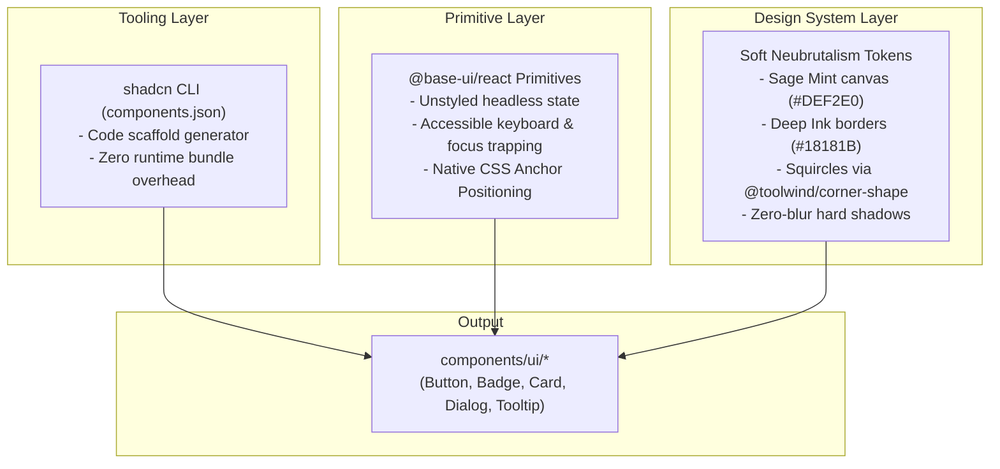

# 05 — Component System & shadcn + Base UI Architecture

## 1. The shadcn + Base UI Hybrid Architecture

In `nmrisrl-v3`, we combine **shadcn/ui's component distribution model** with **Base UI's headless primitives** ([`@base-ui/react`](https://base-ui.com)) and our **Soft Neubrutalism design tokens**.



---

## 2. Why There Are Zero Bottlenecks or Conflicts

1. **No Monolithic Runtime**: `shadcn` is not a library dependency inside `package.json`. It is purely a CLI code generator that places editable TypeScript source files directly into `components/ui/`.
2. **Headless Base UI**: Unlike UI kits that ship heavy pre-baked CSS styles, `@base-ui/react` has zero default styles and renders zero redundant wrapper divs.
3. **Token Aliasing**: In `app/globals.css`, shadcn's expected semantic variables are linked directly to your neubrutalist tokens:

```css
@theme {
	/* Semantic shadcn / Base UI Aliases */
	--color-background: var(--color-canvas); /* #DEF2E0 */
	--color-foreground: var(--color-ink); /* #18181B */
	--color-card: var(--color-surface); /* #FFFFFF */
	--color-card-foreground: var(--color-ink); /* #18181B */
	--color-primary: var(--color-coral); /* #FF6B57 */
	--color-primary-foreground: #ffffff;
	--color-secondary: var(--color-canvas-subtle); /* #EAF6EC */
	--color-secondary-foreground: var(--color-ink);
	--color-border: var(--color-ink); /* #18181B */
	--color-ring: var(--color-ink);
}
```

_When an agent or developer adds a component using shadcn's conventional classes (`bg-primary`, `border-border`, `bg-background`), it automatically inherits your exact palette without manual re-theming._

---

## 3. Configuration: `components.json`

Located in the repository root:

```json
{
	"$schema": "https://ui.shadcn.com/schema.json",
	"style": "new-york",
	"rsc": true,
	"tsx": true,
	"tailwind": {
		"config": "",
		"css": "app/globals.css",
		"baseColor": "neutral",
		"cssVariables": true,
		"prefix": ""
	},
	"iconLibrary": "lucide",
	"rtl": false,
	"aliases": {
		"components": "@/components",
		"utils": "@/lib/utils",
		"ui": "@/components/ui",
		"lib": "@/lib",
		"hooks": "@/hooks"
	}
}
```

---

## 4. Core Component Manifest

All core components live inside `components/ui/`:

### A. Button (`components/ui/button.tsx`)

- **Behavior**: Interactive tactile click physics (`hover:-translate-x-0.5 hover:-translate-y-0.5`, `active:translate-x-0.5 active:translate-y-0.5` with shadow collapse).
- **Shape**: Squircle fallback (`rounded-lg corner-squircle supports-[corner-shape:squircle]:rounded-full`).
- **Variants**: `default` (Coral), `secondary` (Surface White), `yellow`, `lavender`, `sky`, `outline`, `ghost`.
- **Polymorphism**: Supports `asChild` for seamless `<Link>` or `<a>` nesting without invalid nested button HTML.

### B. Badge (`components/ui/badge.tsx`)

- **Behavior**: Compact pill chip with `border-[1.5px] border-ink` and `shadow-[2px_2px_0px_var(--color-ink)]`.
- **Variants**: `default`, `coral`, `yellow`, `lavender`, `sky`, `mint`, `outline`.

### C. Card (`components/ui/card.tsx`)

- **Behavior**: Structured floating container with `border-[2.5px] border-ink` and `shadow-brutal`.
- **Shape**: Continuous squircle curvature (`rounded-2xl corner-squircle supports-[corner-shape:squircle]:rounded-[28px]`).
- **Subcomponents**: `CardHeader`, `CardTitle`, `CardDescription`, `CardContent`, `CardFooter`.

### D. Dialog / Modal (`components/ui/dialog.tsx`)

- **Powered by**: `@base-ui/react/dialog`.
- **Anatomy**: `Dialog`, `DialogTrigger`, `DialogContent`, `DialogHeader`, `DialogTitle`, `DialogDescription`, `DialogClose`.
- **Features**: Accessible focus lock, Escape key dismissal, backdrop dimming (`bg-ink/40 backdrop-blur-xs`), and `shadow-brutal-lg`.

### E. Tooltip (`components/ui/tooltip.tsx`)

- **Powered by**: `@base-ui/react/tooltip`.
- **Features**: Native CSS anchor positioning without JavaScript measurement jitter, squircle badge styling.

---

## 5. Layout & Architectural Grid System (`components/page-layout/`)

The layout incorporates a structural grid line system with subtle hairline framing:

- **`PageLayout` (`components/page-layout/page-layout.tsx`)**: Master shell wrapping pages in a continuous central column framed by vertical `border-x border-ink/15` rails that span full height.
- **`Navbar` (`components/page-layout/navbar.tsx`)**: Sticky top navigation with brand identity on the left, right-aligned navigation links, and a responsive mobile menu.
- **`GridSection` (`components/page-layout/grid-section.tsx`)**: Reusable section container with `border-b border-ink/15`, numbered section headers, and corner intersection crosshairs (`+`) rendered on the joints.
