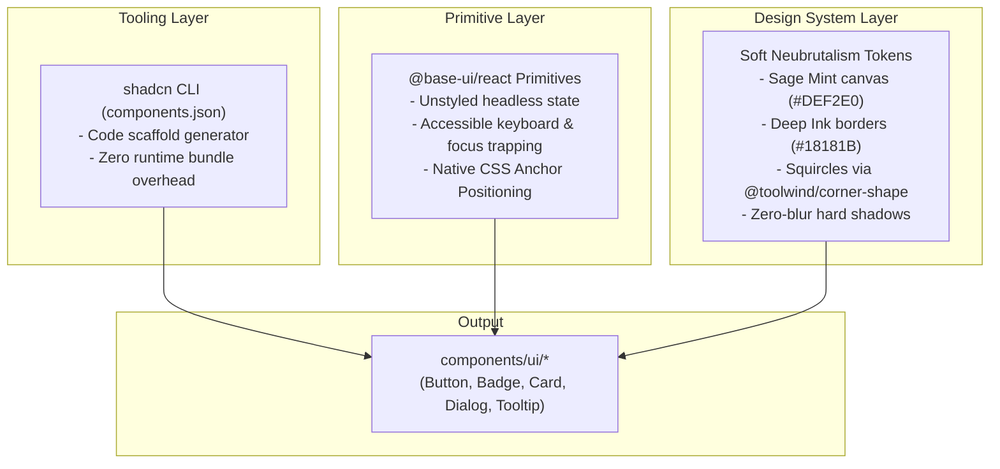

# 05 — Component System & shadcn + Base UI Architecture

## 1. The shadcn + Base UI Hybrid Architecture

In `nmrisrl-v3`, we combine **shadcn/ui's component distribution model** with **Base UI's headless primitives** ([`@base-ui/react`](https://base-ui.com)) and our **Soft Neubrutalism design tokens**.



---

## 2. Why There Are Zero Bottlenecks or Conflicts

1. **No Monolithic Runtime**: `shadcn` is not a library dependency inside `package.json`. It is purely a CLI code generator that places editable TypeScript source files directly into `components/ui/`.
2. **Headless Base UI**: Unlike UI kits that ship heavy pre-baked CSS styles, `@base-ui/react` has zero default styles and renders zero redundant wrapper divs.
3. **Token Aliasing**: In `app/globals.css`, shadcn's expected semantic variables are linked directly to your neubrutalist tokens:

```css
@theme {
	/* Semantic shadcn / Base UI Aliases */
	--color-background: var(--color-canvas); /* #DEF2E0 */
	--color-foreground: var(--color-ink); /* #18181B */
	--color-card: var(--color-surface); /* #FFFFFF */
	--color-card-foreground: var(--color-ink); /* #18181B */
	--color-primary: var(--color-coral); /* #FF6B57 */
	--color-primary-foreground: #ffffff;
	--color-secondary: var(--color-canvas-subtle); /* #EAF6EC */
	--color-secondary-foreground: var(--color-ink);
	--color-border: var(--color-ink); /* #18181B */
	--color-ring: var(--color-ink);
}
```

_When an agent or developer adds a component using shadcn's conventional classes (`bg-primary`, `border-border`, `bg-background`), it automatically inherits your exact palette without manual re-theming._

---

## 3. Configuration: `components.json`

Located in the repository root:

```json
{
	"$schema": "https://ui.shadcn.com/schema.json",
	"style": "new-york",
	"rsc": true,
	"tsx": true,
	"tailwind": {
		"config": "",
		"css": "app/globals.css",
		"baseColor": "neutral",
		"cssVariables": true,
		"prefix": ""
	},
	"iconLibrary": "lucide",
	"rtl": false,
	"aliases": {
		"components": "@/components",
		"utils": "@/lib/utils",
		"ui": "@/components/ui",
		"lib": "@/lib",
		"hooks": "@/hooks"
	}
}
```

---

## 4. Core Component Manifest

All core components live inside `components/ui/`:

### A. Button (`components/ui/button.tsx`)

- **Behavior**: Purely vertical 3D tactile click physics (`hover:-translate-y-0.5 hover:shadow-brutal-lg`, `active:translate-y-0.5 active:shadow-brutal-xs`).
- **Border & Shadow Architecture**: Built on the outset **`ring-2 ring-ink shadow-brutal`** pattern to eliminate sub-pixel anti-aliasing seams and prevent squircle border/shadow divergence.
- **Accessible Focus**: Styled with `focus-visible:outline-2 focus-visible:outline-offset-2 focus-visible:outline-ink` so focus indicators never overwrite or collide with the 2px ring outline.
- **Shape**: Squircle fallback (`rounded-lg corner-squircle supports-[corner-shape:squircle]:rounded-full`).
- **Variants**: `default` (Coral), `secondary` (Surface White), `yellow`, `lavender`, `sky`, `outline`, `ghost`.
- **Polymorphism**: Supports `asChild` for seamless `<Link>` or `<a>` nesting without invalid nested button HTML.

### B. Badge (`components/ui/badge.tsx`)

- **Behavior**: Compact pill chip with canonical `border-subtle border-ink` and 3D vertical `shadow-brutal-xs`.
- **Variants**: `default`, `coral`, `yellow`, `lavender`, `sky`, `mint`, `outline`.

### C. Card (`components/ui/card.tsx`)

- **Behavior**: Structured floating container with canonical `border-brutal border-ink` (2px) and 3D vertical `shadow-brutal`.
- **Shape**: Continuous squircle curvature (`rounded-2xl corner-squircle supports-[corner-shape:squircle]:rounded-[28px]`).
- **Subcomponents**: `CardHeader`, `CardTitle`, `CardDescription`, `CardContent`, `CardFooter`.

### D. Dialog / Modal (`components/ui/dialog.tsx`)

- **Powered by**: `@base-ui/react/dialog`.
- **Anatomy**: `Dialog`, `DialogTrigger`, `DialogContent`, `DialogHeader`, `DialogTitle`, `DialogDescription`, `DialogClose`.
- **Features**: Accessible focus lock, Escape key dismissal, backdrop dimming (`bg-ink/40 backdrop-blur-xs`), and `shadow-brutal-lg`.

### E. Tooltip (`components/ui/tooltip.tsx`)

- **Powered by**: `@base-ui/react/tooltip`.
- **Features**: Native CSS anchor positioning without JavaScript measurement jitter, squircle badge styling (`shadow-brutal-xs`).

---

## 5. App-Specific & Experience Primitives (`components/custom/`)

> **Architectural Boundary**: `@/components/ui/*` is strictly reserved for registry-backed primitives and their local styled wrappers installed or scaffolded from Base UI and shadcn registries (such as `button`, `card`, `badge`, `dialog`, `tooltip`). All bespoke application components, interactive controllers, and micro-experience features reside in `@/components/custom/*` to keep the UI directory clean and registry-compatible.

### A. Custom Cursor (`components/custom/cursor.tsx`)

- **Inspired by**: [Animate UI Cursor Primitive](https://animate-ui.com/docs/primitives/animate-ui/cursor).
- **Styling**: Coral body (`#FF6B57`), Chalk White outline (`#FFFFFF`, 2.5px), and 2px zero-blur brutal ink shadow (`drop-shadow(0px 2px 0px rgba(24, 24, 27, 0.95))`).
- **Precision Alignment**: Arrow hotspot locked to exact `(1.5px, 3px)` tip coordinates, preventing pointer click-target desynchronization.
- **Haptic Micro-interactions**: Smooth click scaling (`scale: 0.88` on press), clickable hover reactions (`scale: 1.15` and subtle tilt over buttons/links), and text caret transparency (hides over text fields).
- **Platform Safety**: Excludes touch-only devices via `(hover: hover) and (pointer: fine)` query; honors `prefers-reduced-motion`.

### B. Click Effect Primitive (`components/custom/click.tsx`)

- **Inspired by**: [Animate UI Click Primitive](https://animate-ui.com/docs/primitives/animate-ui/click).
- **5 Configurable Variants**:
  - `burst` (Default): Directional speed-lines erupting in the 180°–270° quadrant behind the arrow tip with brutal ink drop shadows.
  - `particles`: 360° radiating circular confetti with white borders (supports `multiColor` brand palette).
  - `crosshair`: Architectural 4-tick crosshair expanding outward matching `GridSection` `[+]` indicators.
  - `ring`: Tactile expanding shockwave ring.
  - `ripple`: Soft expanding radial wash.
- **Immediate Tactile Physics**: Defaults to `trigger="pointerdown"` for instant 0ms haptic response on mouse press.
- **Toggleable 3D Drop Shadow**: Includes `showShadow?: boolean` on `<Click />` (and `clickEffectShadow?: boolean` on `<CustomCursor />`) to easily switch between 3D neubrutalist drop shadows or flat, clean vectors.
- **Future Customization & SFX Hook**: Equipped with `onEffectTrigger?: (item) => void` callback ready for audio sound effects (SFX) and user preference switchers.

---

## 6. Layout & Architectural Grid System (`components/page-layout/`)

The layout incorporates a 3-column structural grid framework with decorative striped gutter rails inspired by `tailwindcss.com`:

- **`PageLayout` (`components/page-layout/page-layout.tsx`)**:
  - **3-Column Architectural Framework**: `grid min-h-dvh justify-center grid-cols-1 md:grid-cols-[2.5rem_minmax(0,72rem)_2.5rem] lg:grid-cols-[3rem_minmax(0,72rem)_3rem]`.
  - **Flanking Striped Gutter Rails**: Left and right columns feature continuous vertical `border-x border-ink/15 bg-striped-rail` rails (`hidden md:block`).
  - **Single Inner Boundary**: The inner borders of the flanking rails serve as the outer boundary for the central 72rem (`max-w-6xl`) stage, preventing doubled lines.
  - **Mobile Overflow Safeguards**: Enforces `w-full overflow-x-clip`, explicit `grid-cols-1`, and `min-w-0 w-full` on child stages to guarantee zero horizontal scroll.

- **`Navbar` (`components/page-layout/navbar.tsx`)**:
  - **Persistent Floating Island Dock**: Centered header (`sticky top-0 z-50 flex w-full justify-center px-3 py-3 sm:px-6 sm:py-4`).
  - **Squircle Card Shell**: Built on `bg-surface/95 shadow-brutal ring-2 ring-ink backdrop-blur-md corner-squircle` with dynamic height scaling (`h-14 max-w-4xl` default, `h-12 max-w-3xl` scrolled).
  - **Brand Badge**: `nmrisrl` logo with a rotated Warm Coral `.dev` squircle chip (`bg-coral text-white border-subtle shadow-brutal-xs`).
  - **Direct Action**: Text-only `Let's Talk` CTA button smoothly scrolling to `#contact`. Redundant "Contact" link removed from navigation items.
  - **Mobile Dropdown & Accessible Focus**: Compact floating squircle dropdown card attached beneath the island dock with touch-friendly navigation links and full-width CTA. Mobile hamburger toggle enforces visible keyboard focus (`focus-visible:outline-2 focus-visible:outline-offset-2 focus-visible:outline-ink`).

- **`GridMarker` (`components/page-layout/grid-marker.tsx`)**:
  - **Architectural Junction Anchor**: Renders at grid line corners and section divider intersections with transform-based precision centering (`-translate-x-1/2 translate-y-1/2`).
  - **Squircle Box Default with Progressive Fallback**: Defaults to `"squircle"` (`size-2.5 rounded-xs corner-squircle supports-[corner-shape:squircle]:rounded-full border border-ink/40 bg-surface shadow-brutal-xs`), providing a clean CAD terminal cap that upgrades v2's box with G2 continuous curvature.
  - **Dynamic Neu-Icons Selection**: Supports 10 handcrafted vector Neu-Icons (`diamond-star`, `cross-star`, `rounded-cross`, `propeller-star`, `trefoil-cloud`, `sunburst-flower`, etc.) as well as custom `ReactElement` overrides.
  - **Auto-Adaptive Silhouette Drop Shadows**: Automatically maps `shadow-brutal*` to `drop-shadow-brutal*` on SVG icons via boundary-safe negative lookaround regex (`(?<![\w-])shadow-brutal*`) to preserve existing drop shadows while preventing box-shadow bounding artifacts.
  - **Custom Element Styling**: Custom `ReactElement` markers receive `markerClassName` via `cloneElement` class merging (or a wrapper `<span>`) while preserving existing absolute corner positioning.

- **`GridSection` (`components/page-layout/grid-section.tsx`)**:
  - Reusable architectural section container bounded by `border-b border-ink/15` (`px-4 py-16 md:px-8 lg:px-12`).
  - **Streamlined Marker Props**: Accepts `marker?: GridMarkerVariant | ReactElement` (defaults to `"squircle"`), `markerClassName?: string`, `showMarker?: boolean` (defaults to `true`), and `showTopMarker?: boolean` (defaults to `false`).
  - **Editorial Blueprint Headers**: Supports `figure`, `figureMeta?: string | string[]`, `number`, `title`, and `description` to render technical blueprint section kickers.

---

## 7. Hero Section & Marquee System (`components/sections/hero/`)

- **`HeroSection` (`components/sections/hero/hero-section.tsx`)**:
  - Natural content-driven height (`flex flex-col justify-between px-0! py-0`) avoiding excessive vertical empty space while maintaining visual balance.
  - **Avatar Stage & Floating Accents Anchor Pattern**:
    - The character avatar and all its floating graphic accents are wrapped inside a dedicated inner stage wrapper (`relative w-full max-w-65 sm:max-w-85 md:max-w-95 lg:max-w-100`).
    - This architecture ensures all absolute positions (`-left-3`, `-right-3`, `bottom-12`) anchor directly to the avatar's silhouette across all viewports (desktop, tablet, mobile), preventing badges from drifting across full-width columns on smaller screens.
    - **`RotatingSeal` (`components/sections/hero/rotating-seal.tsx`)**: Circular rotating SVG badge (`Crafted with care • 2026 • Nomer Israel • Frontend •`) with center `CrossStarIcon` stamp from `@/components/neu-icons` (`size-5.5 text-ink`), positioned at the top-left of the avatar stage (`-top-6 -left-3 lg:-top-8 lg:-left-6`, honors `motion-reduce:animate-none`).
    - **`BauhausAccent` (`components/sections/hero/bauhaus-accent.tsx`)**: Bauhaus geometric accent pill (`● ▲ ■ SYS.V3 // CRAFT`) at the avatar's bottom-left waistline (`bottom-20 -left-3 lg:bottom-24 lg:-left-4`, `-rotate-2`).
    - **`GitCommandBadge` (`components/sections/hero/git-command-badge.tsx`)**: Neubrutalist git command pill (`>_ git commit -m "feat"`) stepped down beneath Bauhaus on the lower waist/pants (`bottom-6 left-2 lg:bottom-8 lg:left-4`, `-rotate-1`, customizable via `command` prop).
    - **`NpmDevBadge` (`components/sections/hero/npm-dev-badge.tsx`)**: Neubrutalist developer command pill (`>_ npm run dev`) framing the lower-right wrist/pocket of the avatar (`-right-2 bottom-12 lg:-right-3 lg:bottom-14`, `rotate-2`).
    - **Mobile Safeguard**: Floating badges use `hidden sm:inline-flex` (`hidden sm:flex` for RotatingSeal) to ensure clean rendering without overflow or clutter on mobile devices (`< sm`).
  - **Editorial Hero Typography**:
    - **Blueprint Coordinates**: `✦ FIG. 01 // OVERVIEW • 14°35'N 120°58'E • MNL, PH` with responsive wrapping.
    - **Availability Kicker**: `[ 🟢 AVAILABLE FOR WORK ]` squircle pill with pulsing mint indicator (equipped with `motion-reduce:animate-none`).
    - **Headline**: `Plus Jakarta Sans` headline with responsive sizing (`text-3xl sm:text-5xl`) and yellow highlight box (`beyond the code.`).
    - **Dual Action CTAs**: Clean `[ Explore Projects ]` (default coral) and `[ Get in Touch ]` (secondary white) buttons.

- **`MarqueeTechStack` (`components/sections/hero/marquee-tech-stack.tsx`)**:
  - Dual-track infinite counter-translating marquee powered by `motion/react`.
  - Top track translates Left; bottom track translates Right (reverse).
  - Populated strictly from [`ProfileCoreTech`](file:///C:/Users/NOMER%20ISRAEL/OneDrive/Desktop/Projects/nmrisrl-v3/constants/stack-and-skills-data.ts) in `constants/stack-and-skills-data.ts`.
  - Contained inside the grid rails (`w-full overflow-hidden`) with refined borders (`border-t border-ink/20`, `border-b border-ink/15`) and edge fade masks (`bg-linear-to-r`).

---

## 8. About Section Bento Grid Architecture (`components/sections/about/`)

The About section showcases professional identity, core specialization, engineering metrics, architectural mindset, and personal interests structured into a high-contrast Soft Neubrutalist Bento Grid:

- **`AboutSection` (`components/sections/about/about-section.tsx`)**:
  - **Blueprint Header**: Rendered with `figure="FIG. 02 // IDENTITY & BACKGROUND"` and `figureMeta={["SPECIALIZATION", "CRAFT & SYSTEMS"]}`.
  - **12-Column Responsive Bento Layout**: `grid grid-cols-1 gap-4 sm:gap-5 md:grid-cols-2 lg:grid-cols-12`.
  - **Code-Split Modular Subcomponents**: Subdivided into 6 focused card components for maintainability:
    1. **`SpecializationCard` (`md:col-span-2 lg:col-span-7`)**: Large anchor card highlighting React ecosystem expertise, type safety, and micro-interactions. Features 4 branded tech pills (`React`, `Next.js`, `TypeScript`, `Tailwind CSS`) powered by official Simple Icons.
    2. **`ExperienceCard` (`md:col-span-2 lg:col-span-5`)**: High-contrast engineering metric (`7+ Years Crafting UI`), designer-intuition narrative, interactive hover lift, and a Scallop Rosette seal stamp chip.
    3. **`ArchitectureCard` (`md:col-span-1 lg:col-span-6`)**: Architectural methodologies (Feature-Sliced Design, Clean Architecture, Domain-Driven Design) accented with `DoubleCapsuleIcon`.
    4. **`InnovationCard` (`md:col-span-1 lg:col-span-6`)**: Active radar tracking modern frontend advancements (Web Standards, Modern Tooling, Emerging Trends) with a pulsing trend indicator and `SlantedLoopIcon`.
    5. **`NorthStarCard` (`md:col-span-2 lg:col-span-5`)**: Engineering standards and core values (Purpose, Mastery, Freedom) accented with `PropellerStarIcon`.
    6. **`InterestsCard` (`md:col-span-2 lg:col-span-7`)**: Personal pursuits (Distance Running routine, Game Development interest, 2D Character Art admiration) with Lucide icons (`Footprints`, `Gamepad2`, `Palette`) and `TrefoilCloudIcon`.

- **`AboutIcons` (`components/sections/about/about-icons.tsx`)**:
  - Official brand SVG icons (`ReactIcon`, `NextjsIcon`, `TypeScriptIcon`, `TailwindIcon`) sourced directly from Simple Icons (`simpleicons.org`).
  - Standard `24x24` viewBox, `fill="currentColor"` cascade, and accessible `title` tags.

---

## 9. Neubrutalist Accent Icon Library (`components/neu-icons/`)

A dedicated set of 10 bespoke Soft Neubrutalism SVG accent icons designed to be used purposefully across cards, badges, section headers, and micro-accents without visual overuse.

### A. Shared Interface & Props Architecture (`types.ts`)

All icons share the lightweight `NeuIconProps` interface:

```tsx
import type { ComponentProps } from "react";

export interface NeuIconProps extends ComponentProps<"svg"> {
	/**
	 * Explicit square dimension helper (applies to width & height).
	 * Defaults to 24 (paired with the `size-6` class).
	 */
	size?: number | string;
}
```

- **Default Styling**: Applies `className={cn("inline-block shrink-0 select-none", fill === "currentColor" && "fill-current", size === 24 && !width && !height && "size-6", className)}`.
- **Color Inheritance**: Built with `fill="currentColor"` by default, conditionally injecting `fill-current` so icons automatically inherit active text colors (`text-ink`, `text-coral`, `text-yellow`) while allowing non-current fill values (`fill="none"`, `fill="#FF6B57"`) to pass through without CSS class collisions. Explicit Tailwind utility overrides (`fill-coral`, `stroke-ink`) on `className` remain fully functional.
- **Flexible Sizing**: Sizing can be controlled via the `size` prop (`size={32}`), HTML attributes (`width`, `height`), or standard Tailwind size classes (`className="size-8"`).
- **Accessibility Safeguard**: Automatically assigns `aria-hidden="true"` by default for purely decorative accents, or dynamically switches to `role="img"` if `aria-label` or `aria-labelledby` is passed.

### B. Complete Icon Manifest

| Component Name       | File Path                                  | Shape Description                                 |
| :------------------- | :----------------------------------------- | :------------------------------------------------ |
| `PropellerStarIcon`  | `components/neu-icons/propeller-star.tsx`  | 4-blade curved propeller star / astroid clover    |
| `RoundedCrossIcon`   | `components/neu-icons/rounded-cross.tsx`   | Rounded Greek plus / Swiss cross with pill arms   |
| `SlantedLoopIcon`    | `components/neu-icons/slanted-loop.tsx`    | Diagonal tilted infinity loop / peanut silhouette |
| `DoubleCapsuleIcon`  | `components/neu-icons/double-capsule.tsx`  | Vertical dual capsule / cassette pill pair        |
| `TrefoilCloudIcon`   | `components/neu-icons/trefoil-cloud.tsx`   | 3-bubble trefoil cloud cluster                    |
| `ScallopRosetteIcon` | `components/neu-icons/scallop-rosette.tsx` | 4-corner scalloped rosette / flower badge         |
| `DonutRingIcon`      | `components/neu-icons/donut-ring.tsx`      | Circular donut ring / target torus                |
| `DiamondStarIcon`    | `components/neu-icons/diamond-star.tsx`    | 8-point faceted diamond sparkle star              |
| `CrossStarIcon`      | `components/neu-icons/cross-star.tsx`      | 4-point rounded cross star / flare                |
| `SunburstFlowerIcon` | `components/neu-icons/sunburst-flower.tsx` | 8-petal blooming sunburst daisy flower            |

### C. Import Patterns

Both direct module imports and explicit package imports are supported:

```tsx
// Direct module import (fastest Turbopack HMR compilation)
import { DiamondStarIcon } from "@/components/neu-icons/diamond-star";

// Package import (explicit named exports from components/neu-icons/index.ts)
import { DiamondStarIcon, PropellerStarIcon } from "@/components/neu-icons";
```
