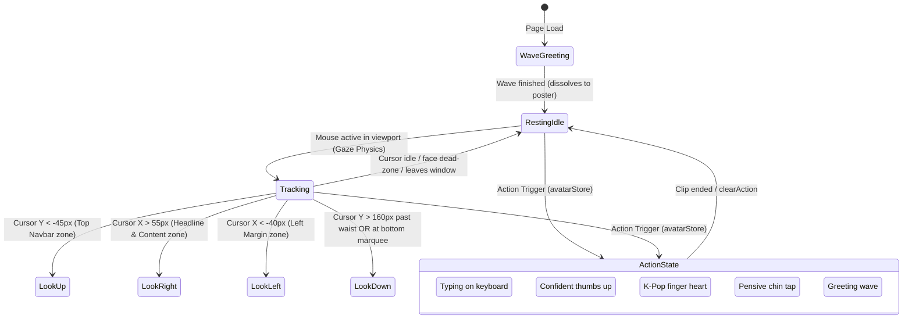

# 06 — Avatar Interactive Engine

## 1. Asset Manifest

All avatar assets are stored in `public/avatar/`. They are encoded in **WebM (VP9 codec, CRF 24, `-g 12` mouse-tracking keyframes)** with zero audio overhead, ensuring all files are under 1.4 MB for instantaneous frame playback.

| File Name                     | Purpose                       | Duration / Type              | Trigger Event                                                                                         |
| ----------------------------- | ----------------------------- | ---------------------------- | ----------------------------------------------------------------------------------------------------- |
| **`avatar-idle.webm`**        | Base idle loop                | Looping video                | Default on-screen state                                                                               |
| **`avatar-idle.webp`**        | High-res fallback poster      | Static image                 | Video loading / mobile fallback                                                                       |
| **`avatar-wave.webm`**        | Welcoming wave gesture        | Play once $\rightarrow$ idle | Page initial entrance greeting, triggerable action                                                    |
| **`look-left.webm`**          | Gaze directed left            | Spring scrub (2.2s cap)      | Cursor in left viewport zone                                                                          |
| **`look-right.webm`**         | Gaze directed right           | Spring scrub (2.2s cap)      | Cursor over hero headline / content                                                                   |
| **`look-up.webm`**            | Gaze directed upwards         | Spring scrub (2.2s cap)      | Cursor in upper zone / navbar tabs                                                                    |
| **`look-down.webm`**          | Gaze directed downwards       | Spring scrub (3.8s cap)      | Cursor past waist or on marquee fold                                                                  |
| **`avatar-thinking.webm`**    | Pensive chin tap              | Looping video                | Project card inspection, idle timeout inside window                                                   |
| **`avatar-coding.webm`**      | Typing on mechanical keyboard | Looping video                | Hero "Explore Projects" CTA hover, Bauhaus Accent click, Git Command badge click, NPM Dev badge click |
| **`avatar-thumbsup.webm`**    | Confident thumbs up           | Play once $\rightarrow$ idle | Hero "Get in Touch" CTA hover, Rotating Seal badge click, Contact form message sent                   |
| **`avatar-fingerheart.webm`** | K-pop finger heart + wink     | Play once $\rightarrow$ idle | Interactive Avatar direct click (or Enter/Space keyboard trigger), Footer / Tip jar Easter egg        |

---

## 2. Interactive State Machine & Store (`avatarStore`)

The avatar engine operates as a hybrid state machine supporting both continuous physics-based directional gaze scrubbing and discrete contextual action video clips. The action layer is governed by a lightweight singleton store (`components/avatar/avatar-store.ts`) integrated with React 19's `useSyncExternalStore`.



### Action Priority Hierarchy & Preemption

Actions are queued or rejected based on their `ActionPriority`:

- **`idle` (Priority 0)**: Default state when no contextual animation is active.
- **`hover` (Priority 1)**: Transient actions triggered by hovering over UI elements (e.g. Hero CTA buttons, navigation tabs).
- **`click` (Priority 2)**: High-intent tactile actions triggered by explicit user clicks (e.g. clicking the interactive avatar, clicking the `RotatingSeal`, `BauhausAccent`, `GitCommandBadge`, or `NpmDevBadge`).

**Preemption Rules**:

1. An incoming action with **strictly lower priority** than the active action is rejected (e.g. hovering over "Explore Projects" (`hover`) will NOT interrupt an active `fingerheart` or `thumbsup` triggered by a direct click (`click`)).
2. An incoming action with **greater or equal priority** preempts the active action immediately.
3. When `clearAction(sourceOrAction)` is invoked, it only clears the active action if the provided filter matches the active action or requester source, preventing mismatched race conditions across fast hover movements.
4. Non-looping clips (`thumbsup`, `fingerheart`, `wave`) self-clean by attaching an `ended` event listener to their `<video>` element, automatically returning the engine to `idle`.
5. Tactile badge triggers (`RotatingSeal`, `BauhausAccent`, `GitCommandBadge`, `NpmDevBadge`) schedule bounded releases (3000ms–3500ms) to ensure the avatar resets to idle even if playback is interrupted or the component unmounts.

---

## 3. Mouse Tracking, Spring Physics & Spatial Calibration

The engine uses a critically-damped harmonic oscillator spring solver (`solveSpring`) in `components/avatar/use-avatar-gaze.ts` to map mouse coordinates into fluid video scrubbing:

```typescript
// Critically-damped spring oscillator
const solveSpring = (
	current: number,
	velocity: number,
	target: number,
	dt: number,
	omega = 7.0,
): [number, number] => {
	const overshoot = target + (target - 0.5) * 2 * 0.08;
	let newVel = velocity + (omega * omega * (overshoot - current) - 2 * omega * velocity) * dt;
	newVel = Math.max(-2.8, Math.min(2.8, newVel));
	let newPos = clamp01(current + newVel * dt);
	if ((newPos === 0 && newVel < 0) || (newPos === 1 && newVel > 0)) newVel = 0;
	return [newPos, newVel];
};
```

### Spatial Zone Calibration:

- **Dead Zone**: Distance $\le 50\text{px}$ around face center $\rightarrow$ Neutral resting idle pose.
- **Top Zone (`LOOK_CLIPS[2]`)**: $dy < -45\text{px}$ $\rightarrow$ Look Up (prioritized for navbar, tabs, and top header).
- **Content Zone (`LOOK_CLIPS[1]`)**: $dx > 55\text{px}$ $\rightarrow$ Look Right (reads statement headline, personalized bio, and CTA buttons).
- **Left Margin Zone (`LOOK_CLIPS[0]`)**: $dx < -40\text{px}$ $\rightarrow$ Look Left.
- **Downward Zone (`LOOK_CLIPS[3]`)**:
  - Vertically below avatar's lower waist: $dx \in [-100, 70]\text{px} \land dy > 160\text{px}$ (prevents premature look down near chin/chest).
  - Bottom marquee fold: $Y > \text{rect.bottom} - 20\text{px} \land dy > \max(60, |dx| \times 0.7)$.

---

## 4. Layered Video Architecture & Reversal Transitions

All clips share identical camera framing, lighting, and `#DEF2E0` Sage Mint canvas background. Layering and crossfading are coordinated to eliminate visual flashes or blinking:

```text
Layer 4 (Top):    Initial Welcome Wave Video (/avatar/avatar-wave.webm) [zIndex: 5, auto-plays once, dissolves out on completion or action trigger]
Layer 3:          Contextual Action Videos (/avatar/avatar-*.webm) [zIndex: 4, fades in 0 -> 1 over 240ms]
Layer 2:          Incoming Directional Video (zIndex: 2, fades in 0 -> 1 over 220ms, spring scrubs currentTime)
Layer 1:          Outgoing Directional Video (zIndex: 1, stays 100% opaque underneath until incoming is solid)
Layer 0 (Base):   Resting Idle Poster (/avatar/avatar-idle.webp) [Permanent high-res base]
```

### Transition Mechanics:

1. **Direction Switch Reversal**: When changing directions (e.g., Look Up $\rightarrow$ Look Right), the active video smoothly rewinds toward frame 0 before the incoming clip activates.
2. **Gaze Neutralization on Action**: When a contextual action triggers (`avatarStore`), directional gaze tracking smoothly eases back to neutral (`currentProgress -> 0`), preventing awkward head tilts during gestures.
3. **Action Crossfading**: The active action video mounts at `zIndex: 4` and fades in over 240ms. On completion or preemption, it crossfades smoothly back to the idle poster or to the next action over 240ms.
4. **Solid-Layer Crossfade**: The outgoing directional clip stays at `zIndex: 1` with 100% opacity for 220ms while the incoming clip fades in at `zIndex: 2`. This guarantees no see-through drop to the background.
5. **Throttled Scrubbing**: `seekVideo` applies a `SEEK_TOLERANCE = 0.02s` threshold to prevent frame-seek thrashing on high refresh-rate monitors (120Hz/144Hz).

---

## 5. Hero Integration, Feathering & Marquee Collision

### Seamless Background Integration

The video and image assets are rendered natively with a solid `#DEF2E0` Sage Mint background matching the page canvas (`bg-canvas`). Rather than applying artificial radial gradient masks (which can feather character edges or cause ghostly see-through transparency during video playback), the character renders with 100% solid opacity and crisp silhouettes, blending natively with the hero section background.

### Bottom Collision & Inner Stage Wrapper Layout

In `components/sections/hero/hero-section.tsx`:

- The avatar column uses `items-end self-end` with `pb-0 mb-0`.
- The avatar rests directly on top of the `MarqueeTechStack` border with **zero margin and zero padding**, creating a seamless tactile collision where the character emerges directly above the moving tech ticker.
- **Stage Framing**: The avatar is wrapped with its surrounding floating badges in an inner stage container (`relative w-full max-w-65 sm:max-w-85 md:max-w-95 lg:max-w-100`). This ensures all absolute coordinates (`-left-3`, `-right-3`, `bottom-12`) anchor directly to the avatar's silhouette across all viewports, preventing floating badges from drifting away on tablet/mobile screens.
- **Responsive Image Sizes**: The resting base poster (`Image`) specifies `sizes="(max-width: 640px) 260px, (max-width: 768px) 340px, (max-width: 1024px) 380px, 400px"` to optimize asset decoding and eliminate layout shift warnings.
