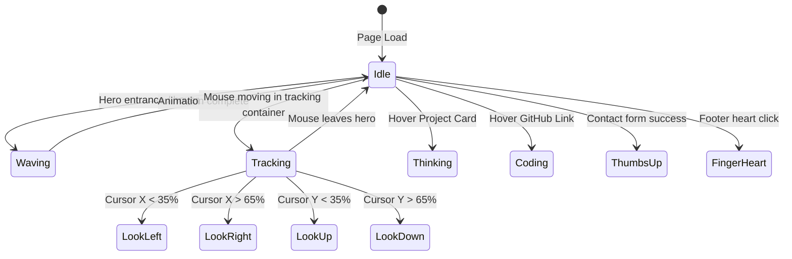

# 06 — Avatar Interactive Engine

## 1. Asset Manifest

All avatar assets are stored in `public/avatar/`. They are encoded in **WebM (VP9 codec, CRF 24, `-g 12` mouse-tracking keyframes)** with zero audio overhead, ensuring all files are under 1.4 MB for instantaneous frame playback.

| File Name                     | Purpose                       | Duration / Type              | Trigger Event                           |
| ----------------------------- | ----------------------------- | ---------------------------- | --------------------------------------- |
| **`avatar-idle.webm`**        | Base idle loop                | Looping video                | Default on-screen state                 |
| **`avatar-idle.webp`**        | High-res fallback poster      | Static image                 | Video loading / mobile fallback         |
| **`avatar-wave.webm`**        | Welcoming wave gesture        | Play once $\rightarrow$ idle | Page initial entrance / Hero card hover |
| **`look-left.webm`**          | Gaze directed left            | Dynamic scrub / loop         | Cursor in left viewport zone            |
| **`look-right.webm`**         | Gaze directed right           | Dynamic scrub / loop         | Cursor in right viewport zone           |
| **`look-up.webm`**            | Gaze directed upwards         | Dynamic scrub / loop         | Cursor in upper viewport zone           |
| **`look-down.webm`**          | Gaze directed downwards       | Dynamic scrub / loop         | Cursor in lower zone / Marquee inspect  |
| **`avatar-thinking.webm`**    | Pensive chin tap              | Play once $\rightarrow$ idle | Project card inspection                 |
| **`avatar-coding-v2.webm`**   | Typing on mechanical keyboard | Play once $\rightarrow$ idle | GitHub button hover / Code tab click    |
| **`avatar-thumbsup.webm`**    | Confident thumbs up           | Play once $\rightarrow$ idle | Contact form message sent               |
| **`avatar-fingerheart.webm`** | K-pop finger heart + wink     | Play once $\rightarrow$ idle | Footer / Tip jar Easter egg             |

---

## 2. Interactive State Machine



---

## 3. Mouse Tracking & Spring Physics

To avoid frantic jitter when the user moves the mouse slightly, pointer coordinates are smoothed using a spring-damped tracker (`motion` or damped linear interpolation `lerp`):

```typescript
// Smooth spring damping calculation
const springConfig = { damping: 25, stiffness: 120 };
```

### Zone Detection Logic:

- **Center / Idle Zone**: $35\% \le X \le 65\%$ and $35\% \le Y \le 65\%$ $\rightarrow$ `avatar-idle.webm`
- **Left Zone**: $X < 35\%$ $\rightarrow$ `look-left.webm`
- **Right Zone**: $X > 65\%$ $\rightarrow$ `look-right.webm`
- **Up Zone**: $Y < 35\%$ $\rightarrow$ `look-up.webm`
- **Down Zone**: $Y > 65\%$ $\rightarrow$ `look-down.webm`

---

## 4. Video Transition Strategy

All directional videos are rendered in identical camera positioning and lighting. Crossfading is handled through layered HTML `<video>` elements with absolute positioning:

```tsx
<div className="relative size-full overflow-hidden bg-canvas">
	{/* Base Idle Video */}
	<video
		src="/avatar/avatar-idle.webm"
		autoPlay
		loop
		muted
		playsInline
		className="absolute inset-0 size-full object-cover transition-opacity duration-300"
		style={{ opacity: currentZone === "idle" ? 1 : 0 }}
	/>

	{/* Look Left Video */}
	<video
		src="/avatar/look-left.webm"
		autoPlay
		loop
		muted
		playsInline
		className="absolute inset-0 size-full object-cover transition-opacity duration-200"
		style={{ opacity: currentZone === "left" ? 1 : 0 }}
	/>

	{/* Look Right Video */}
	<video
		src="/avatar/look-right.webm"
		autoPlay
		loop
		muted
		playsInline
		className="absolute inset-0 size-full object-cover transition-opacity duration-200"
		style={{ opacity: currentZone === "right" ? 1 : 0 }}
	/>
</div>
```

### Performance & Memory Rules:

1. All video elements **MUST** include `muted`, `playsInline`, and `preload="auto"`.
2. Directional scrub videos (`look-left`, etc.) pause when offscreen using `IntersectionObserver` to save mobile GPU bandwidth.
3. Preload the primary idle clip in `app/layout.tsx`:
   ```html
   <link rel="preload" href="/avatar/avatar-idle.webm" as="video" type="video/webm" />
   ```
